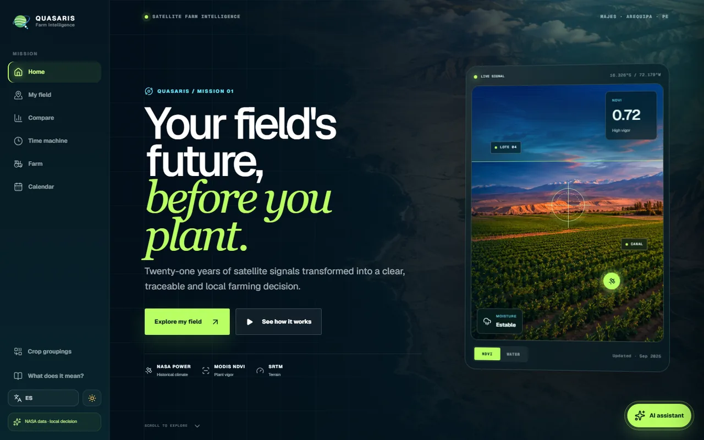
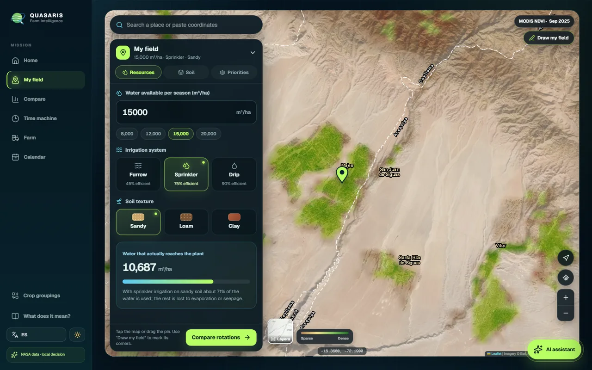
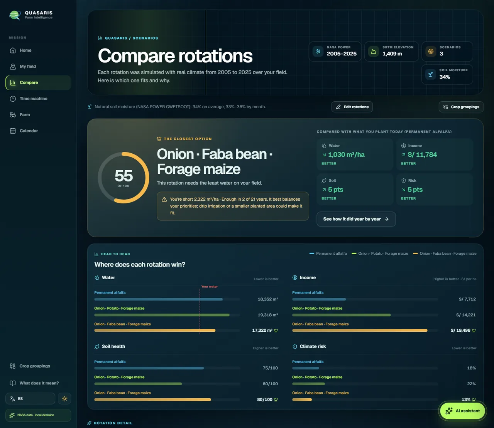
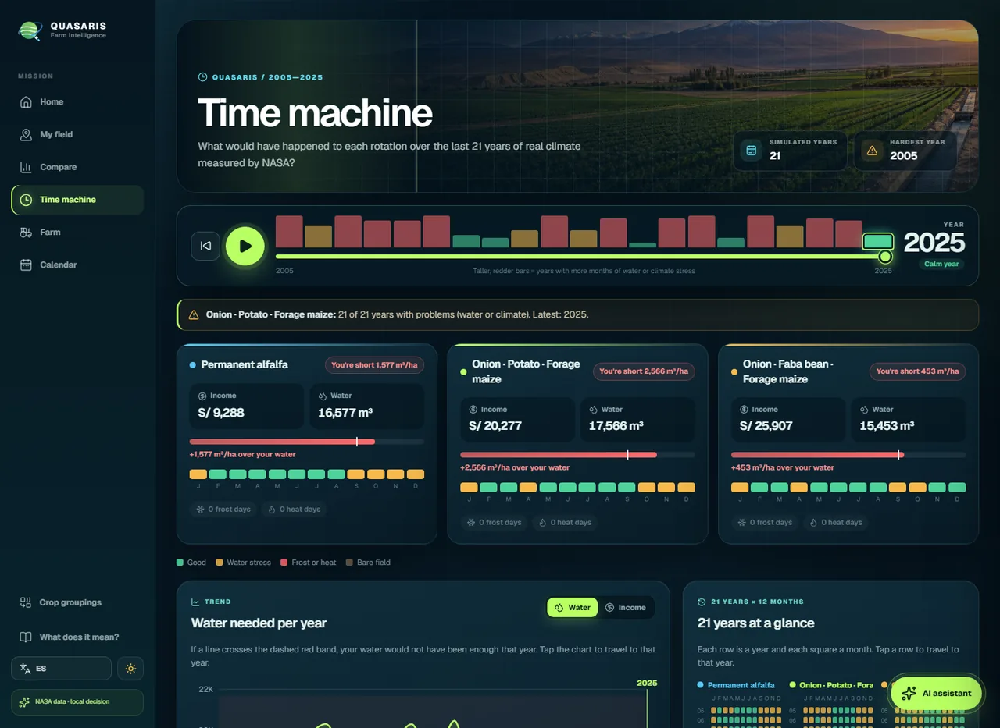
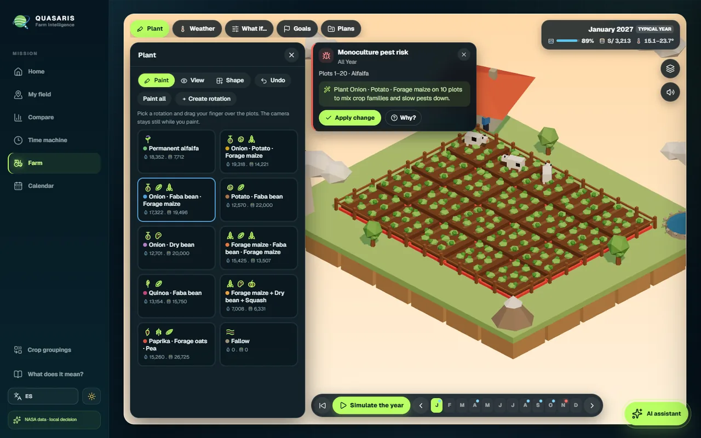
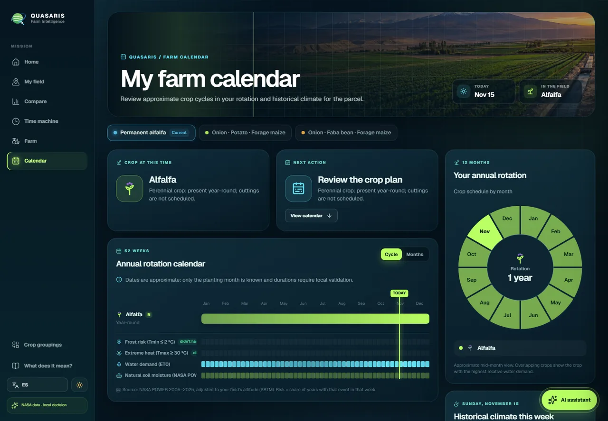
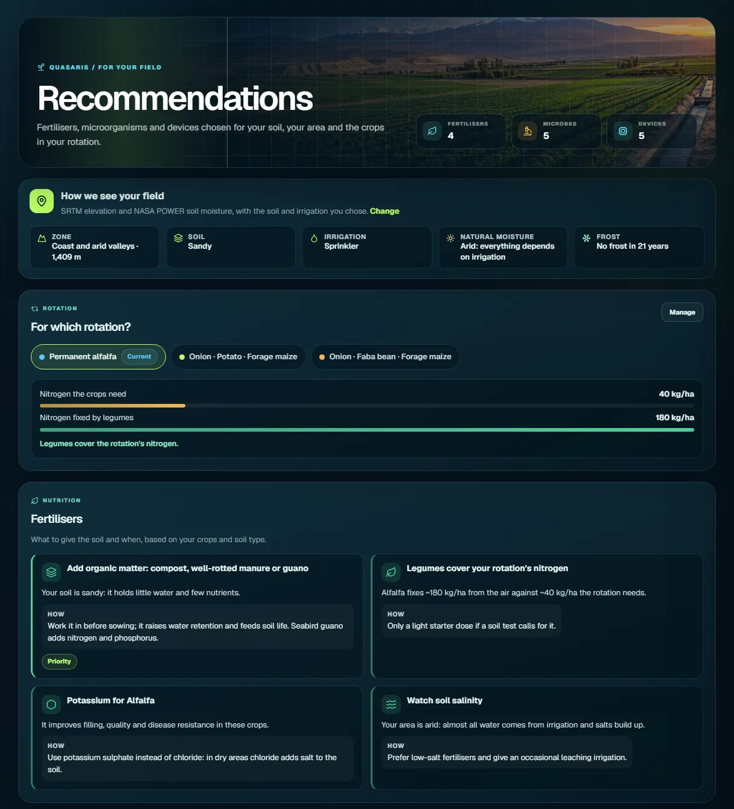
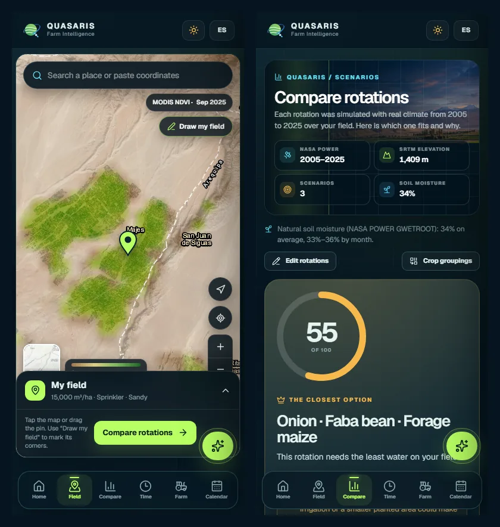
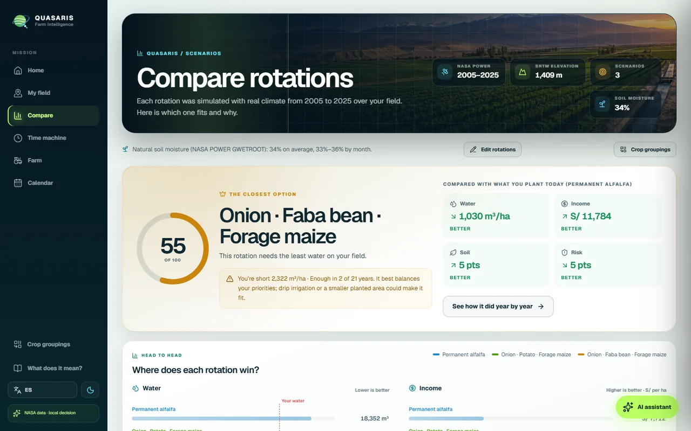

# Quasaris FarmTwin

**From Space to Soil.** A bilingual (Spanish/English) Progressive Web App that helps farmers in the Majes irrigation district (Arequipa, Peru) compare crop rotations with NASA data before they plant.

NASA Space Apps Challenge 2026 · challenge **Field Shift: Adapting Farms with NASA Data** · team Quasaris.

**Live app:** https://quasaris-farmtwin.vercel.app



## Summary

The farmer marks their field on a satellite map (or draws its outline) and enters their water allocation, irrigation system, soil and priorities. FarmTwin then compares crop rotations, including the one the farmer grows today, using 21 years of daily NASA POWER climate adjusted to the field's real altitude with NASA SRTM terrain data. For each rotation it estimates water demand (FAO-56 Penman-Monteith), income, soil health and climate risk, shown as a range across years instead of a single number.

The app is organised around **past, present and future**:

- **Past:** a time machine replays every rotation over 2005–2025 next to monthly MODIS NDVI from NASA GIBS.
- **Present:** a live calendar shows this week's frost, heat and water demand and sends push alerts, and a Recommendations screen suggests fertilisers, beneficial microorganisms and field devices for the farmer's soil, zone and crops.
- **Future:** a 3D farm simulation and an AI assistant let the farmer test a season before sowing it.

FarmTwin supports the judgment of the farmer and the local agronomist. It does not replace it.

## Product tour

Six steps, from the satellite view to a plan the farmer can act on. All screenshots come from the live app.

### 1. Locate the field

Search a place or paste coordinates, then tap once inside the field: the outline is detected on the satellite image and opens with draggable corners (drawing by hand is still available). NASA MODIS NDVI shows active vegetation; the side panel collects water, irrigation system, soil texture and priorities, and shows how much water actually reaches the crop.



### 2. Compare rotations

The current rotation is compared with the alternatives under 21 years of real climate. The verdict says which one fits best and what changes against today. When water is short, the app says how many m³/ha are missing and in how many of the 21 years the water would have been enough, instead of a bare "not viable". A "What you can do" plan lists concrete actions for the current rotation (irrigation, crops, soil care, risky months) with their estimated effect, ordered by the farmer's priorities. Head-to-head charts show where each rotation wins.



### 3. Travel through 21 years

The time machine replays every rotation year by year (2005–2025). Taller, redder bars mark years with more months of water or climate stress; each card shows that year's income, water need and monthly status.



### 4. Play the next season

A 3D digital twin of the farm. The farmer paints crops on the plots, picks a scenario (typical year, dry year, El Niño or a hotter future) and simulates the season month by month. Alert cards explain each risk and propose a fix.



### 5. Plan the year

The calendar shows each crop's cycle, the annual rotation wheel, weekly historical frost and heat risk, and this week's irrigation estimate. Push alerts warn before risky weeks.



### 6. Get recommendations for the field

FarmTwin reads the field's profile (zone from SRTM altitude, dryness from NASA POWER root-zone wetness, frost from the 21 years, plus soil and irrigation) and the crops of the chosen rotation. It then suggests fertilisers (nitrogen balance with legume fixation, organic matter by soil type, phosphorus, potassium, salinity care), beneficial microorganisms (Rhizobium inoculants, mycorrhizae, Trichoderma, Beauveria, Bt and others, chosen from each crop's pests and diseases) and devices (flow meter, moisture sensor, drip kit with estimated savings, frost station, salinity meter, pest traps). Every card says why it applies to this field and how to do it.



### Mobile, light and dark

The app is mobile-first and installable as a PWA. A sun/moon button switches between dark and light themes; the choice is remembered.

<p>
  
  
</p>

## Features

| Screen | What it does |
| --- | --- |
| **My field** | Full-screen satellite map with NASA NDVI and SMAP layers, place search (local zones, coordinates or OpenStreetMap), one-tap field outline detection on the satellite image (image processing in the browser, editable corners) and a tool to draw the outline by hand and measure its area. Floating panels for water, irrigation, soil (ISRIC SoilGrids) and priorities. |
| **Compare** | At least 3 rotations (including the current one) with water, income, soil health, climate risk, typical months, how many m³/ha of water are missing and in how many of the 21 years the water was enough, a "What you can do" action plan, an explanation of the fit score, and what to check with an expert. |
| **Recommendations** | Fertilisers, beneficial microorganisms and devices tailored to the field's soil, zone (SRTM altitude, NASA POWER soil wetness, frost history) and the crops of each rotation, with the reason and how to apply each one. Rule-based guidance, to be confirmed with an agronomist and SENASA-registered products. |
| **Time machine** | What each rotation would have produced in every year from 2005 to 2025, with animated playback, a per-year chart, a 21-year strip and that month's NDVI. |
| **Farm** | A 3D digital twin of the farm for the **next season**. The island takes the shape of the drawn field (square plots inside the outline) and can be reshaped by adding or removing edge plots. The farmer paints crops, picks a scenario (typical year, dry year, El Niño or +1.5 °C, each modelled on a real NASA POWER year) and plays the season month by month, or switches to Past to replay any real year from 2005 to 2025. Layouts can be saved as plans and compared side by side in past years and next-season scenarios (profit and whether the water lasts). On-screen alert cards say how often each risk happened in the 21 real years, which plots are affected and what to change, with a one-tap "Apply change". Supports intercropping (associations such as the *milpa* and the three sisters). |
| **Calendar** | Crop cycles and stages, weekly frost and heat risk, this week's irrigation and push alerts. |
| **Assistant** | AI chat with voice dictation and photo upload. It answers with numbers that come only from the engine through tool calls. |
| **My rotations / Groupings** | Build custom rotations or crop associations from 16 crops grown around Arequipa and compare them on every screen. A full-page guided setup (crops, calendar, review) helps create the first rotation. |
| **My plan** | A printable farm plan (PDF) with the chosen rotation, calendar and risks. |
| **What does it mean?** | Ten plain-language ideas (water, seen from space, risk and decisions), each one a short expandable card. |
| **Light and dark theme** | A sun/moon button in the sidebar (and in the mobile top bar) switches themes; the choice is saved in the browser. |

## How it works

```
Field (lat, lon) ──► SRTM: real altitude ──► pick the 2 NASA POWER cells that bracket it
                                                  │  interpolate day by day (2005–2025)
                                                  ▼
          data quality checks (ranges, gaps, spikes, unreliable years)
                                                  ▼
          ET0 Penman-Monteith FAO-56 ──► ETc = Kc × ET0 ──► gross irrigation / efficiency
                                                  │
          frost and heat per crop ──► income ──► soil health (rules) ──► score by priorities
                                                  ▼
                 results per year (time machine) + median and p10–p90 range
```

- **Engine:** Python (FastAPI) in `engine/` and `api/py/`, deployed as a Vercel Python function.
- **App:** Next.js 16 (App Router) PWA with offline mode and push notifications.
- **Data and validation:** [`docs/DATA_SOURCES.md`](docs/DATA_SOURCES.md) · [`docs/VALIDATION.md`](docs/VALIDATION.md) · AI use: [`docs/AI_USAGE.md`](docs/AI_USAGE.md)

## Technology

| Layer | Tools |
| --- | --- |
| Frontend | Next.js 16, React 19, TypeScript, Tailwind CSS 4, Leaflet / react-leaflet, Recharts, Three.js / React Three Fiber, lucide-react |
| Backend and engine | Python 3.12, FastAPI, NumPy, pytest |
| AI assistant | Vercel AI SDK with tool calling, through Vercel AI Gateway or OpenRouter |
| Platform | Vercel (Next.js + Python functions, daily cron, Blob storage for push subscriptions), Web Push (VAPID), service worker |
| Data | NASA POWER, NASA SRTM, NASA GIBS (MODIS NDVI, SMAP L4), ISRIC SoilGrids, FAO-56, MIDAGRI, OpenStreetMap Nominatim, Esri basemaps |

## Open items

| Item | Owner | Detail |
| --- | --- | --- |
| SENAMHI Pampa de Majes data (station 116006) | Team | Manual download; steps in `docs/VALIDATION.md` §3. Then run `python scripts/validate_senamhi.py` |
| Majes water scenario | Team | Confirm the water allocated per hectare and the most common irrigation system. Defaults: sprinkler and 15,000 m³/ha (estimate) in `lib/farm-store.ts` and `scripts/make_mock.py` |
| Prices, yields and costs | Agronomist | Estimated values in `data/crops.json` |
| Sowing dates of the "Income" rotation | Agronomist | Potato (August, 145 days) overlaps maize for 43 days when maize is sown in December; the `/rotaciones` editor flags it. Adjust in `data/rotations_majes.json` |
| Recommendation rules | Agronomist | Fertiliser, microorganism and device rules in `lib/recommendations.ts` and crop nutrient, pest and disease data in `data/crops.json` |

## Run locally

Requirements: Node 22 or later and Python 3.12 or later.

```bash
npm install
python -m venv .venv
# Windows: .venv\Scripts\activate   ·   macOS/Linux: source .venv/bin/activate
pip install -r requirements-dev.txt

npm run dev:py   # Python engine at http://127.0.0.1:8000 (docs at /api/py/docs)
npm run dev      # PWA at http://localhost:3000 (proxies /api/py/* to the engine)
```

If the engine does not respond, the PWA uses the last saved result and, if there is none, `data/mock_simulate.json` (a snapshot of the real engine for Majes).

| Script | What it does |
| --- | --- |
| `npm run dev` / `npm run build` | Next.js PWA |
| `npm run dev:py` | FastAPI engine with auto-reload |
| `npm run test:py` | Engine tests (FAO-56, data fusion, quality checks, simulation, associations) and contract tests |
| `npm run mock` | Regenerates `data/mock_simulate.json` with the real engine |
| `npm run icons` | Regenerates the PWA icons |
| `python scripts/fetch_power_cache.py` | Downloads the NASA POWER cells around Majes into `data/power_cache/` |
| `python scripts/validate_senamhi.py` | Compares NASA POWER with the SENAMHI station (requires the CSV files) |

The service worker and push alerts only work in production (`npm run build && npm start`, or on Vercel).

### Try the assistant

Set `OPENROUTER_API_KEY` or `AI_GATEWAY_API_KEY` in `.env.local`. OpenRouter uses `openrouter/free` by default so the chat works without credit; change it with `OPENROUTER_MODEL`, for example `anthropic/claude-sonnet-4.6` if you have credit. AI Gateway uses `anthropic/claude-sonnet-5.5` and accepts `AI_GATEWAY_MODEL`. The chosen model must support images and tools.

Open `/es/asistente` or `/en/asistente`. Ask what happens with 20% less water and open **View comparison** to check the adjustment. If the Python engine is not available, the chat uses the mock and labels it as demo data. If the engine runs in another project or port, set `ENGINE_URL` on the server.

The microphone relies on the browser's speech recognition. Test voice in Chrome on Android and a JPEG, PNG or WebP photo through **Attach photo**.

## Project structure

```
app/[locale]/        pages (URL paths): parcela (my field), comparar (compare), tiempo (time
                     machine), granja (farm), calendario (calendar), asistente (assistant),
                     rotaciones (my rotations), agrupaciones (groupings), recomendaciones
                     (recommendations), onboarding (first rotation), plan, aprende (glossary)
app/api/             chat (assistant + tools), push/subscribe, push/test, cron/alerts
app/manifest.ts      PWA manifest              public/sw.js   service worker (offline and push)
components/          map/, cards/, timemachine/, calendar/, granja/
lib/                 contract.ts, engine-client.ts, farm-store.ts, granja-store.ts, granja-sim.ts,
                     granja-fixes.ts, farm-shape.ts, crop-calendar.ts, grouping.ts, recommendations.ts,
                     auto-parcel.ts (one-tap field outline), water-fit.ts, push-server.ts, gibs.ts,
                     geo.ts, i18n.ts
messages/            Spanish and English UI text
api/py/index.py      FastAPI: /api/py/health · /api/py/simulate · /api/py/climate
engine/              schema, power (POWER + SRTM fusion), quality, elevation, et0, crops,
                     rotation, simulate, tests/
data/                crops.json, rotations_majes.json, mock_simulate.json, power_cache/,
                     soilgrids/, senamhi/
docs/                DATA_SOURCES.md, AI_USAGE.md, VALIDATION.md, screenshots/
```

## Deployment

The Vercel project `quasaris-farmtwin` is linked to this repository: **every push to `main` deploys to production** and every branch gets a preview. `vercel.json` routes `/api/py/*` to the Python function and schedules the daily alerts cron (12:00 UTC).

Environment variables (already set on Vercel): `NEXT_PUBLIC_VAPID_PUBLIC_KEY`, `VAPID_PRIVATE_KEY`, `CRON_SECRET` and `BLOB_READ_WRITE_TOKEN` (private Blob store for push subscriptions), plus the assistant keys above.

## For coding agents

> Read `CHALLENGE_CONTEXT.md`, `PLAN.md` (§4 to §8), `README.md` and `lib/contract.ts`. Only change the files of your task. Respect the contract (`lib/contract.ts` ↔ `engine/schema.py`); if you need to change it, stop and tell the team. Run `npm run build`, `npx eslint .` and `npm run test:py` before pushing.
