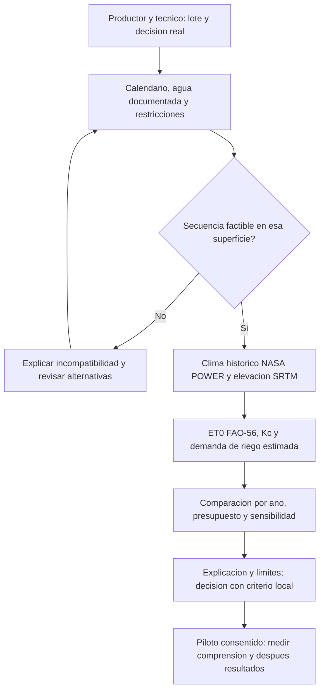

# Quasaris FarmTwin — Auditoría estratégica, científica y de impacto

**Fecha:** 15 de noviembre de 2026, America/Lima.\
**Perspectiva:** mentoría crítica para NASA Space Apps; no constituye evaluación oficial de NASA ni validación agronómica.\
**Versión examinada:** commit `3ddfaffa95a7313e090a6f273a1e24fb3936fc7e`, árbol inicialmente limpio.\
**Alcance autorizado:** investigación, lectura, reproducción y este informe. No se modificaron la aplicación, el motor ni los datasets. Las correcciones descritas son propuestas.

## 1. Veredicto ejecutivo

**Quasaris tiene una base útil para comparar demanda de riego bajo clima histórico, pero todavía no justifica recomendar a un agricultor qué sembrar.** La reproducibilidad del software es buena; la validez de la decisión agrícola sigue abierta. Presentarlo mañana como explorador acompañado por un técnico es defendible, con límites visibles. Presentarlo como un digital twin validado que predice ganancias, salud del suelo o ahorro real de agua no lo es.

La evidencia más determinante es reproducible:

- Los 36 tests Python pasan; también TypeScript, lint y build. El motor reproduce exactamente el snapshot de demostración.
- Las dos alternativas predeterminadas tienen calendarios incompatibles en una misma hectárea: **43 y 20 días de solapamiento**, respectivamente. La primera requiere 405 días-cultivo y la segunda 370 dentro de un año de 365 días. Cambiar únicamente las fechas no resuelve la primera.
- Durante el solapamiento, el motor conserva el mayor Kc diario, pero contabiliza ingresos de todos los cultivos. Duplicar una alfalfa en la misma parcela eleva el margen de S/11.000 a S/22.000/ha sin aumentar la demanda de agua. El ranking acepta esa alternativa.
- Con los valores predeterminados —aspersión, suelo arenoso, 15.000 m³/ha/año— ninguna rotación cubre su demanda mediana. La alternativa de menor demanda necesita 17.322 m³/ha/año y solo cabe en el presupuesto en 2 de 21 años simulados.
- La disminución modelada frente a alfalfa es **1.030 m³/ha/año, 5,6%**, para esa alternativa inválida. No demuestra ahorro realizable.
- El fallback puede mostrar resultados de otra configuración como si correspondieran a la actual. El snapshot declara `source.power="cache"`, por lo que las advertencias condicionadas a `"mock"` no lo identifican como demostración.

Estos resultados proceden de [rotation.py](../engine/rotation.py), [simulate.py](../engine/simulate.py), [engine-client.ts](../lib/engine-client.ts) y reproducciones de esta auditoría, detalladas en §2 y §15.

**El problema regional existe; la formulación actual simplifica demasiado al productor.** La [ANA documentó restricciones de siembra por disponibilidad hídrica en 2015][S08]; [AUTODEMA documentó problemas de drenaje en B-3 en 2025][S10]. Esto no demuestra un déficit uniforme ni una dotación actual de 15.000 m³/ha para cada agricultor. Tampoco permite tratar a un ganadero con alfalfa establecida como si pudiera cambiar libremente a horticultura.

**Decisión estratégica:** conservar Majes como territorio, delimitar el piloto a productores con una superficie anual realmente disponible para cambiar de secuencia, y trabajar inicialmente con un técnico. El producto debe responder primero: **«¿Esta secuencia cabe en mi parcela, mi calendario y mi agua?»**

## 2. Qué hace Quasaris hoy realmente

### 2.1 Evidencia y alcance de inspección

Se leyeron `README.md`, `PLAN.md`, `CONTEXTO_RETO.md`, los tres documentos científicos solicitados y los módulos de cálculo, contratos, datos, clientes, calendario, agrupaciones, modo granja, mapas, asistente, service worker, plan y configuración de despliegue. **No existe `CHALLENGE_CONTEXT.md`; su equivalente es `CONTEXTO_RETO.md`.**

La evaluación de la interfaz se basa en sus componentes, textos y compilación; no incluye observación de agricultores, pruebas táctiles en Android ni una sesión interactiva completa de navegador. Se verificó por GET que el endpoint público `/api/py/health` respondía 200 y declaraba Python 3.12.16. Eso no verifica el resto del servicio ni demuestra que producción corresponda exactamente al commit local.

Una consulta de simulación externa fue rechazada por la revisión automática de permisos por exportar configuraciones locales a un endpoint público. No se ejecutó ni se intentó por otra vía. Las simulaciones se reprodujeron **localmente**, con el código y los datos del repositorio. No se enviaron notificaciones, mensajes ni consultas al proveedor LLM.

### 2.2 Inventario con estado de evidencia

| Componente | Evidencia observada | Clasificación y límite |
| --- | --- | --- |
| POWER histórico | Cuatro archivos, 2005–2025, siete variables; dos celdas participan en el caso base | Implementado y reproducido. No validado contra estación local |
| FAO-56 ET0 | Funciones vectorizadas, tests de los ejemplos 8 y 18 | Implementado y probado numéricamente; exactitud local pendiente |
| Interpolación por altitud | SRTM y ponderación de dos celdas | Implementada y probada algebraicamente; método climático no validado |
| Comparación de rotaciones | Agua, margen, índice de suelo, riesgo y score | Implementada; alternativas predeterminadas agronómicamente inválidas |
| Time machine | Resultados por año y mes, gráficos y mapas sincronizados | Implementada; replay de hipótesis, no rendimientos observados |
| Calendario | Ciclos aproximados y climatología semanal; texto advierte que no es pronóstico | Implementado; cálculo semanal probado parcialmente |
| Alertas push | Suscripciones, Blob, VAPID y cron diario | Código y configuración presentes. Entrega real y utilidad no verificadas |
| Modo granja 3D | Reparto por casillas, acumulaciones, escenarios y eventos | Implementado; mezcla resultados del motor con reglas adicionales no calibradas |
| Agrupaciones | Compatibilidad, N, plagas, raíces y LER por reglas | Implementado como heurística; sin validación agronómica local |
| SoilGrids | Resumen regional cacheado, cuantiles, cobertura y advertencias | Implementado. No es extracción específica de cada parcela ni balance de suelo |
| MODIS NDVI / SMAP | Teselas NASA GIBS | Visualización. No alimentan agua, rendimiento ni recomendaciones |
| Asistente | Tool calling, dictado, foto y cambios de prioridades/agua | Implementado en código. Sin evaluación de respuestas en esta auditoría |
| Offline | localStorage y service worker | Implementado parcialmente; correspondencia solicitud–resultado defectuosa |
| Plan imprimible | `window.print()` y resumen por grupos | Implementado; PDF depende de imprimir/guardar desde el navegador |
| SENAMHI | Script de comparación y procedimiento de descarga | Preparado, sin CSV ni resultados locales de validación encontrados |
| Pronóstico meteorológico, HLS parcelario, asignación colectiva de agua | Referencias en planes | Planificados, no implementados en el cálculo actual |
| Uso por agricultores e impacto | Sin registros, entrevistas o ensayos documentados | No demostrado; no equivale a afirmar que nadie haya abierto la app |

### 2.3 Qué se comprobó ejecutando

El `python` del PATH era un alias de Windows sin runtime utilizable. Se preparó Python 3.12.10 portable y dependencias en una carpeta temporal, sin alterar `requirements*.txt`. Las dependencias Python tienen límites inferiores abiertos; la instalación de hoy no representa un entorno congelado de producción.

| Comprobación | Resultado | Qué demuestra |
| --- | --- | --- |
| `python -B -m pytest engine/tests -q -p no:cacheprovider` | **36 passed**, 1 deprecation warning de Starlette/httpx | Ejemplos numéricos, contratos y comportamientos cubiertos |
| `npm run typecheck` | Pasa | Compatibilidad estática TypeScript |
| `npm run lint` | Pasa | Reglas configuradas de ESLint |
| `node scripts/test-crop-calendar.cjs` | Pasa | Casos existentes del calendario |
| `npm run build` | Pasa; 45 páginas generadas | Compilación y prerender del frontend |
| Caso base `run(SimulateRequest(...))` | Igualdad exacta con `mock_simulate.json` | Reproducibilidad del snapshot |
| Diagnósticos adicionales en memoria | Solapamientos, duplicación, agua cero, goteo y fallback | Fallos que los tests existentes no detectan |

**Pasar tests demuestra conformidad con esos tests, no precisión agronómica.** El test de fusión comprueba que los pesos suman uno y que la altitud queda encerrada; no compara temperaturas calculadas con temperaturas observadas.

### 2.4 Resultados reproducidos: únicamente resultados del modelo

Entrada: latitud −16,36; longitud −72,19; 2005–2025; suelo `arenoso`; riego `aspersion`; presupuesto **anual** 15.000 m³/ha; cuatro prioridades de 0,5; rotaciones de `data/rotations_majes.json`. La eficiencia efectiva es `0,75 × 0,95 = 0,7125`.

| Rotación | Agua bruta mediana [p10–p90], m³/ha/año | Margen mediano [p10–p90], S/ha/año | Años con demanda ≤ presupuesto | Solapamiento |
| --- | --- | --- | --- | --- |
| Alfalfa permanente | 18.352 [16.577–19.144] | 7.712 [7.104–9.288] | 0/21 | 0 días |
| Cebolla · Papa · Maíz chala | 19.318 [17.566–20.290] | 14.221 [11.312–20.277] | 0/21 | 43 días |
| Cebolla · Haba · Maíz chala | 17.322 [15.453–18.167] | 19.496 [17.032–25.907] | 2/21 | 20 días |

Estos márgenes usan precios, costos, rendimientos y penalizaciones asumidos; no son ingresos históricos de Majes. La misma tabla no permite comparar directamente forraje autoconsumido con dinero de una cosecha vendida.

Al cambiar **solo** el sistema a goteo, las medianas de demanda pasan a 14.529, 15.293 y 13.713 m³/ha/año; caben en 18/21, 8/21 y 21/21 años. Esto es una consecuencia de dividir por eficiencias fijas. No incluye inversión, energía, mantenimiento ni verificación de uniformidad, y las alternativas mantienen sus calendarios inválidos.

## 3. Alineación con el reto NASA

### 3.1 Qué pudo verificarse oficialmente

El [resumen oficial indexado de Field Shift][S01] pide una herramienta que combine observaciones NASA, información local de suelo, características de cultivos y prioridades para explorar rotaciones que apoyen salud del suelo y adaptación. Quasaris tiene relación directa con ese objetivo.

La página oficial completa y las guías de entrega/evaluación no pudieron descargarse íntegramente por fallos de acceso/TLS. Se revisó el texto completo y sus recursos en la [reproducción de la sede HackAthlone][S02], que remite a NASA como autoridad final. Esa reproducción emplea lenguaje opcional para comparar tres estrategias y para SI/AI, mapas y otras posibilidades. **No convertir esas sugerencias en requisitos oficiales verificados.**

No se verificaron los puntajes, ponderaciones ni la rúbrica particular de Arequipa. `CONTEXTO_RETO.md` es evidencia de lo que el equipo cree que se evaluará, no de lo que NASA o la sede hayan publicado. La existencia de las cinco categorías habituales aparece en [una sede 2026 publicada en el dominio oficial][S03]; no prueba una escala global concreta.

### 3.2 Evaluación del producto frente al objetivo

| Dimensión | Evaluación de mentoría, no puntuación oficial |
| --- | --- |
| NASA Earth observations | Uso sustantivo: POWER cambia ET0 y demanda entre años. SRTM participa en el cálculo. NDVI y SMAP son contexto visual |
| Información local de suelo | Integración débil: textura manual modifica eficiencia; SoilGrids se muestra al lado, sin gobernar almacenamiento, salinidad o aptitud |
| Características de cultivos | Integradas: Kc, duración, umbrales y familia. Falta trazabilidad por parámetro y viabilidad de la secuencia |
| Prioridades del agricultor | Sliders y perfiles funcionan. No representan restricciones obligatorias de forraje, caja, contrato o calendario |
| Salud del suelo | Interpretación por reglas; no una simulación ni validación de cambios de suelo |
| Adaptación | Explora años históricos y perturbaciones. No estima un futuro climático validado |
| Impact | Problema pertinente; beneficiario y cambio de decisión aún no demostrados |
| Creativity | Replay histórico e interpretación local pueden diferenciar. Un dashboard agrícola con AI no basta |
| Validity | Buen punto de partida computacional; debilidades críticas en factibilidad y calibración |
| Relevance | Alta al objetivo general, condicionada a mejorar el vínculo con suelo y decisiones reales |
| Presentation | Demostración visual rica, pero narrativa demasiado amplia y con riesgo de sobreafirmar |

### 3.3 Entrega: confirmado, pendiente y prudente

La [respuesta de un Navigator en `nasa/spaceapps`, discusión 1973][S04] confirma para 2026: demo de hasta 30 segundos o hasta 7 slides, explicación del uso de NASA y AI, acceso público, entrega en inglés o subtítulos ingleses, y cierre el **15 de noviembre a las 23:59, hora local**. La [página 2026 indexada][S05] coincide en el cierre. Para Arequipa/Lima, trabajar con America/Lima; no asumir que la evaluación local del día 16 amplía ese plazo.

Antes de entregar, una persona debe revisar la guía/formulario oficiales disponibles desde su navegador: campos obligatorios, licencias, referencias, política AI y condiciones locales. No se certifica cumplimiento completo de guías inaccesibles. El repositorio público es una buena evidencia técnica, pero no se establece aquí que sea el único formato admisible para el enlace final.

`docs/AI_USAGE.md` contiene TODO y nombres de modelos que esta auditoría no autentica. Debe reflejar lo realmente utilizado, contrastado con registros del equipo, incluyendo imágenes generadas. Una fotografía ilustrativa generada no constituye trabajo de campo.

## 4. Evaluación del marco del mentor

| Principio | Situación actual | Evidencia necesaria o corrección |
| --- | --- | --- |
| Nivel 1: análisis | Alcanzado como prototipo computacional | Mantener reproducción y procedencia |
| Nivel 2: objetivo | Parcial: comparar rotaciones es una tarea, pero falta definir quién puede cambiar qué | Delimitar productor, superficie disponible y restricciones |
| Nivel 3: impacto | No demostrado | Medir comprensión, cambio de decisión y después resultados de campo |
| Beneficiario claro | «Agricultor de Majes» agrupa sistemas distintos | Elegir productor con lote anual flexible, acompañado por técnico |
| Objetivo práctico | El ranking ofrece una respuesta, pero puede recomendar secuencias imposibles | Factibilidad antes de preferencia |
| Democratización NASA | API accesible, castellano y explicaciones son útiles | Comprobar comprensión, conectividad y unidades utilizadas localmente |
| Justificación científica | ET0 sólido en su formulación; cadena posterior débil | Separar ecuaciones, hipótesis y evidencia local |
| Investigación/fieldwork | No se encontró documentación de contacto real | Registrar revisión agronómica e entrevistas auténticas |
| Diagrama de proceso | Pipeline documentado | Mostrar dato → supuesto → comparación → decisión, con límites (§14) |
| Uso NASA significativo | POWER es esencial; otras capas no cambian resultados | Explicar la contribución de cada fuente sin inflar su papel |
| Bibliografía | Documentación inicial útil, muchas fuentes genéricas | Añadir fecha, tabla, unidades y ámbito por parámetro |
| AI funcional | Puede explicar y ajustar un escenario | Medir fidelidad; corregir procedencia y contrato de asociaciones |
| Responsabilidades | `AI_USAGE.md` identifica áreas, aún por confirmar | Asignar responsables humanos de datos, agronomía, UX y pitch |
| Pitch en inglés | No se verificó un artefacto final | Ensayar una decisión y sus límites, sin catálogo de pantallas |

Este marco es una guía de madurez, no tres categorías oficiales de NASA. No se exige probar ahorro de campo durante 48 horas; sí distinguir impacto potencial y observado. Tampoco hay razón para añadir agentes AI si una explicación determinista resuelve la misma tarea.

## 5. Realidad de la agricultura en Majes

### 5.1 Hay un problema documentado, pero tiene varias causas

La nota de la [ANA de enero de 2015][S08] registra una recomendación temporal de no instalar cultivos de alta demanda y una distribución acordada del sistema regulado. Prueba que ajustar siembras a disponibilidad puede ser pertinente; no establece la situación de noviembre de 2026.

La [ANA documentó en 2019 problemas de distribución, presión y caudales][S09]. [AUTODEMA informó en 2025 sobre drenaje y filtraciones en B-3][S10]. La disponibilidad anual, los turnos, la presión de entrega y el drenaje son restricciones distintas. Un total anual por hectárea no describe por sí solo si el agua llega cuando el cultivo la necesita.

El esquema institucional relevante distingue operación de infraestructura mayor y asesoría de AUTODEMA, administración/distribución de organizaciones de usuarios y funciones de ANA/ALA. El productor necesita verificar su entrega y programación concretas. No se debe atribuir toda decisión de distribución a una sola institución ni asumir que un pixel POWER representa el agua de Condoroma o del sistema Colca–Siguas.

### 5.2 Alfalfa, leche y libertad real para cambiar cultivos

El [estudio de producción lechera publicado por UNMSM en 2001][S11] describe la vinculación alfalfa–maíz chala–ganadería y experiencias con sistemas de alimentación. Es evidencia histórica de esa estructura, no un censo actual.

La [intervención INIA en Majes de 2020][S12] confirma trabajo con alfalfa, maíz y la Junta de Usuarios. La [nota municipal de 2023 sobre una planta láctea][S13] documenta una cadena organizada de productores. No es defendible modelar el valor de la alfalfa únicamente como venta de toneladas cuando puede alimentar un hato.

**Inferencia que requiere entrevistas:** un ganadero puede preferir estabilidad de forraje, continuidad de leche y menor necesidad de capital a una horticultura con mayor margen aparente. Reemplazar alfalfa establecida implica además costos de retiro/implantación, transición, trabajo, equipos y riesgo de mercado. El motor no representa esos costos ni la nutrición animal.

La [nota de AGROIDEAS de 2026][S14] documenta reconversión en el distrito hacia uva y antecedentes de cultivos tradicionales. No justifica extrapolar su rentabilidad a todos los usuarios. Un viñedo o un cultivo perenne contratado no es superficie disponible para una rotación anual.

**Distinción territorial:** la irrigación Pampa de Majes/El Pedregal no es intercambiable con todo el valle de Majes o Aplao. Fuentes regionales o del valle deben delimitarse antes de trasladar clima, suelos, cultivos o cifras de población al piloto.

### 5.3 ¿Son plausibles 15.000 m³/ha y la eficiencia elegida?

La [resolución ANA/TNRCH de 2016 sobre asignación en bloques][S15] contiene antecedentes con distintos módulos y volúmenes, incluido 13.500 m³/ha/año para determinadas áreas pendientes de incorporación y asignaciones medidas en distintos puntos. Es un antecedente histórico, **no acreditación de la dotación de una parcela en 2026**.

Como conversión aritmética, 15.000 m³/ha distribuidos continuamente durante 365 días equivalen a unos 0,476 L/s/ha. Esa conversión no incorpora turnos ni pérdidas y no prueba un derecho o entrega efectiva. Se necesita: documento/registro, periodo, superficie de referencia, punto de medición y programación mensual o por turno.

Las eficiencias 0,45/0,75/0,90 son hipótesis de aplicación. Su plausibilidad genérica no valida la eficiencia efectiva de una instalación. El multiplicador adicional por textura que reduce aspersión a 0,7125 carece de fuente local identificable. Sin aforo, uniformidad y condiciones de operación, el contraste con el presupuesto tiene incertidumbre no cuantificada.

### 5.4 Suelo, salinidad y drenaje

El resumen SoilGrids del repositorio sugiere textura arenosa para una región extensa, pero no acredita que todos los lotes sean equivalentes. La evidencia de drenaje en B-3 obliga a admitir heterogeneidad. No se verificó una prevalencia actual de salinidad en toda la irrigación: **no afirmar que todos los suelos de Majes sean salinos**.

No hay en el motor conductividad eléctrica, sodicidad, calidad del agua, nivel freático, requerimiento de lavado ni drenaje. La [FAO-56, capítulo 8][S19], contempla relaciones entre agua disponible, estrés y salinidad que aquí no están implementadas. Ahorrar riego bruto sin considerar esos procesos no garantiza mejorar el suelo. El [INIA ofrece análisis de suelos, aguas y foliares][S16]; el producto puede facilitar la conversación, no sustituir esos análisis.

### 5.5 Información y asesoría que ya existen

[AUTODEMA informó en 2024 que asesoraba automatización de riego desde 2023 en aproximadamente 14 parcelas][S17], utilizando estaciones agroclimáticas, Kc y programación. No hay base para afirmar que los productores carezcan de asesoría o que Quasaris sea el primer acceso a datos para riego.

[AguaRiego, del Instituto Nexus/Purdue][S18], ya permite comparar cultivos y sistemas de riego en Arequipa, incluido Majes. Es el antecedente funcional más relevante encontrado. No se verificó su adopción actual ni su disponibilidad operativa en todos los dispositivos.

**Diferenciación defendible por construir:** comparación histórica año a año de secuencias localmente factibles, con presupuesto documentado y explicación de restricciones. Ser más visual no basta para superar una tabla existente que un técnico ya comprende.

**Conclusión territorial:** Majes es un piloto razonable para decisiones de secuencia y agua en lotes anuales flexibles. El uso genérico «reemplaza alfalfa por una rotación más rentable» está insuficientemente justificado. No se recomienda cambiar de región para ocultar esa debilidad; se recomienda seleccionar mejor el caso de uso y su población.

## 6. Auditoría de credibilidad científica

### 6.1 NASA POWER: resolución y significado

[NASA POWER documenta 0,5° × 0,625° para meteorología y 1° × 1° para radiación solar][S06]. Por tanto, describir todas las entradas como una celda uniforme de unos 50 km es incompleto. [Las variables meteorológicas provienen de reanálisis/asimilación y representan la rejilla del modelo][S07], no mediciones de la parcela. La serie diaria es apropiada para explorar variabilidad regional; no resuelve microclimas internos.

Conservar 2005–2025 como muestra histórica explícita es razonable. La distribución empírica de esos 21 años no es automáticamente la distribución de la próxima campaña, especialmente bajo tendencias, dependencia temporal y cambios de manejo.

### 6.2 SRTM y la «fusión vertical»

El cálculo implementa `w=(z_parcela−z_baja)/(z_alta−z_baja)` y mezcla **todas** las variables entre dos celdas. En el caso base usa elevaciones 835,38 y 1.940,88 m, con pesos aproximadamente 0,481 y 0,519 para 1.409 m.

**Defendible:** emplear elevación en la presión atmosférica de FAO-56 y como covariable para investigar un ajuste térmico. [SRTM es información de elevación, con productos de unos 30/90 m][S20].

**No demostrado:** que escoger celdas geográficamente distintas por su altitud corrija humedad, radiación, viento, precipitación y extremos locales. Costa y sierra no son dos estaciones de un mismo perfil vertical. No se encontró una calibración que demuestre que la mezcla mejora a la celda original.

Además, `elevation.py:20` redondea coordenadas a dos decimales para cachear: puede reutilizar una elevación entre puntos separados aproximadamente un kilómetro. La granularidad del cache no conserva precisión de 90 m. Si SRTM falla, se usa altitud de celda; la respuesta/UI no identifica inequívocamente el origen de esa altitud.

**Remedio:** denominarlo ajuste experimental, comparar alternativas con una estación y conservar la opción sin ajuste como baseline. Validar temperatura antes de sostener que el ajuste mejora heladas; no extender una corrección térmica a todas las variables sin evidencia.

### 6.3 ET0 FAO-56 y lluvia efectiva

[FAO-56, capítulo 2][S21], sustenta Penman–Monteith como método de referencia. `et0.py` implementa sus términos principales, radiación y conversión de unidades; los ejemplos publicados pasan. El uso de RH media para estimar presión de vapor corresponde a una aproximación descrita en [capítulo 3][S22]; el ejemplo de Bruselas pasa `ea` directamente y no valida ese camino específico con POWER.

El motor calcula `ETc=Kc×ET0`, resta lluvia efectiva mensual y divide por eficiencia. La conversión 1 mm = 10 m³/ha es correcta. La lluvia efectiva usa una fórmula USDA-SCS simplificada; **no llamarla ecuación propia de FAO-56** sin una fuente específica.

No hay balance diario de agua en suelo, almacenamiento inicial, escorrentía, drenaje, riego por turno o déficit por etapa. La demanda es una aproximación de planificación. Que exista una función Hargreaves no significa que sea un fallback operacional: `compute_et0()` llama directamente a Penman–Monteith; la limpieza exige radiación y las otras entradas.

### 6.4 Kc, etapas y alfalfa frente a Purdue

Las curvas por etapas son una base reconocible, pero las fechas comienzan siempre el día 1 del mes y las duraciones no cambian con variedad, manejo o temperatura. [FAO-56, capítulo 6][S23], distingue etapas, condiciones estándar y efectos de cortes. Un Kc anual constante de 0,90 puede ser una hipótesis de planificación, pero no es un promedio local medido ni basta para representar cada corte.

El PDF de [AguaRiego, tabla 11, página numerada 14][S18], se descargó y leyó: para alfalfa informa **10.701 m³/ha en 12 meses**. La documentación local consigna 13.219 y +24%. La versión auditada devuelve 18.352 brutos; al multiplicar por 0,7125 se obtienen aproximadamente **13.076 netos**, es decir **+22,2%** frente a esa referencia. La pequeña diferencia de redondeo no explica la distancia con Purdue.

La comparación es **modelo contra modelo**, con entradas y supuestos diferentes. La explicación documental «probablemente por Kc constante y humedad» es una hipótesis, no una atribución comprobada. No se verificó en el manual que su tratamiento de cortes sea exactamente el supuesto por `VALIDATION.md`. Se requiere descomponer clima, Kc, cortes y lluvia para explicarla.

El p10–p90 neto actual es aproximadamente 11.811–13.640 m³/ha: no incluye 10.701. Por tanto, el rango interanual mostrado no cubre ni demuestra haber incorporado esa discrepancia entre métodos. **No usar la frase del documento que sugiere que mostrar un rango ya resuelve esta incertidumbre.**

Sensibilidad local, cambiando solo `kcAvg` en memoria:

| Kc constante supuesto | Demanda bruta mediana, m³/ha/año |
| --- | --- |
| 0,80 | 16.199 |
| 0,90 | 18.352 |
| 1,00 | 20.496 |

Son perturbaciones ilustrativas, no un intervalo de confianza. El cambio de más de 2.100 m³/ha por ±0,10 en Kc supera la diferencia de 1.030 entre las alternativas actuales. No se ha demostrado que la dirección de la ventaja sobreviva a la incertidumbre de parámetros.

### 6.5 Calendarios y contabilidad de superficie: defecto crítico

`place()` en [rotation.py:90](../engine/rotation.py#L90) toma el máximo Kc en los días compartidos. [La contabilización económica:156](../engine/rotation.py#L156) añade todos los cultivos a superficie completa.

| Ejemplo | Ocupación | Implicación |
| --- | --- | --- |
| Ingreso | 150 + 145 + 110 = 405 días-cultivo; 362 días ocupados | 43 días de doble ocupación |
| Suelo/agua | 150 + 110 + 110 = 370; 350 días ocupados | 20 días de doble ocupación |

En «Ingreso», los 43 días se descomponen en **23 papa–maíz en diciembre y 20 maíz–cebolla en marzo**, por la continuación del maíz al año siguiente. No son 43 días únicamente entre papa y maíz, como induce a entender README. El editor advierte, pero el servidor y el ranking no rechazan.

El uso circular del calendario también evalúa una siembra de diciembre con enero–marzo del mismo año de replay, no con los días cronológicamente posteriores de la campaña siguiente. Es una aproximación anual periódica; no una simulación continua de campañas ni una reconstrucción observada.

**Remedio P0:** impedir que una rotación secuencial inválida genere recomendación. No «arreglar» el agua sumando Kc de cultivos que no pueden compartir esa hectárea. Revisar duración, número de campañas o superficie; una asociación real necesita otro diseño y evidencia.

### 6.6 Agua disponible y «viable»

`simulate.py:83` define `viable` como demanda **mediana anual** ≤ presupuesto. No evalúa fiabilidad mínima, turnos, capacidad de entrega ni otras restricciones. `waterFit()` sí cuenta años que caben y es mejor evidencia para el usuario.

`rotation.py` reparte el presupuesto entre 12 y marca estrés mensual cuando la demanda supera 120% de esa parte. Esto no representa automáticamente la distribución real. En el modo granja, una capacidad anual dibujada como reservorio y una demanda acumulada tampoco acreditan almacenamiento físico ni una fecha real de agotamiento.

Usar «compatible con el presupuesto anual introducido en X/21 años históricos, bajo estos supuestos» en lugar de «viable». Si el presupuesto no está documentado, mostrar una sensibilidad y estado de información incompleta, sin convertir 15.000 en dotación local confirmada.

### 6.7 Rendimiento, costos y margen

`incomePEN` es una estimación de margen: rendimiento fijo × precio fijo × factores − costo fijo. No es ingreso bruto ni utilidad empresarial completa. Las referencias «MIDAGRI Arequipa» de `crops.json` no identifican tablas, fechas, variedad, presentación del producto o sistema de manejo.

La pérdida se calcula con 3% por día de frío y 1% por día de calor, con un piso del 30%; la restricción hídrica también conserva al menos 30% del rendimiento. No se encontró calibración por cultivo, etapa, duración del evento o severidad. Con agua disponible cero, la alfalfa conserva **27 t/ha/año modeladas** y arroja margen −S/1.600, frente a −S/7.000 si no hubiese producción. No está validado que esa producción pueda sostenerse con la lluvia/reserva presentes.

Con agua abundante y sin eventos térmicos por sus umbrales, los tres márgenes son constantes durante los 21 años: S/11.000, S/31.700 y S/27.700. Un intervalo económico que colapsa a un punto no significa certeza: evidencia que el modelo no varía precios, costos, productividad o mercado.

El goteo cambia agua y rendimiento penalizado, pero no agrega costo de instalación, energía ni operación. El valor del forraje para leche queda fuera. **Retirar la rentabilidad del papel de recomendación principal hasta validar la definición económica y los insumos.**

### 6.8 Riesgo: un porcentaje con significado equivocado

`risk_by_year` toma el máximo entre pérdida climática estimada y fracción de déficit anual. La mediana de ese valor **no es la probabilidad de helada, de pérdida ni de fracaso**. En el caso base, ninguna de las tres rotaciones registra días sobre sus umbrales de daño por frío/calor en los 21 años, pero la alfalfa muestra «riesgo» mediano de 18,3%: proviene del déficit hídrico.

La pantalla Comparar lo rotula «Riesgo climático». Es una discordancia semántica material. Separar frecuencia histórica de eventos, magnitud del déficit y penalización hipotética. La climatología del calendario, con umbrales generales de 2 °C y 30 °C, tiene una definición distinta; su UI ya lo explica correctamente y conviene preservar esa advertencia.

El score tampoco tiene interpretación absoluta: `simulate.py` normaliza agua e ingreso entre las alternativas presentes, combina pesos y aplica un factor 0,6 a la opción que excede el presupuesto mediano. Añadir otra alternativa puede cambiar la escala y el ranking aunque los resultados agrícolas de las anteriores permanezcan iguales. El déficit influye además en margen y riesgo, por lo que los cuatro sliders no son dimensiones independientes. Un «90/100» no acredita 90% de fiabilidad, idoneidad ni éxito. Mostrar los trade-offs y las restricciones antes del score; no usarlo como evidencia científica de superioridad.

### 6.9 Suelo y nitrógeno

`soil_score()` suma puntos por leguminosas, familias, perennes y raíces, y resta por meses desnudos. No actualiza carbono, nutrientes, salinidad, infiltración o erosión. Un valor de 0,80 no demuestra «80% de salud» ni una mejora de cinco puntos medible en campo.

`evaluateGroup()` suma demanda y fijación de N de fichas y muestra `fixed−demand`. No representa extracción en cosecha, residuos devueltos, mineralización, nodulación, fertilización ni pérdidas; en asociaciones tampoco hace un balance físico por densidad/superficie equivalente. La capacidad de fijar N de una leguminosa no garantiza un aporte neto de esa cantidad al siguiente cultivo, especialmente retirando forraje.

Preservar explicaciones cualitativas de diversificación y cobertura. Renombrar como indicadores de manejo por reglas, no salud medida ni plan de fertilización.

### 6.10 Asociaciones e intercropping

El modelo asigna partes iguales a cada cultivo, promedia Kc, aumenta 10% cuando coinciden y multiplica rendimientos por una tabla de compatibilidad. No es una estimación empírica local de Land Equivalent Ratio. Los valores de companion planting y sus castigos no tienen referencias específicas por combinación.

Una asociación con densidades y patrones espaciales reales no es equivalente a dividir una hectárea en fracciones y aplicar un bonus. Tampoco debe validar una rotación imposible cambiando el selector de modo. Mantenerla como exploración didáctica o retirarla de la demostración principal hasta revisión local.

### 6.11 NDVI, SMAP, SoilGrids y GWETROOT

- El catálogo [WMTS GIBS][S24] se consultó directamente: las capas usadas existen. La mensual NDVI usa `GoogleMapsCompatible_Level7`; no es la serie MOD13Q1 de 250 m mencionada en el contexto inicial. [Los metadatos NASA vinculan la visualización mensual con MOD13A3/MOD13C2][S25]. No atribuir resolución de 250 m a esta capa. Tiles ampliados no aportan nueva información parcelaria.
- SMAP L4 es un producto de modelo/asimilación de escala regional; [NSIDC documenta una malla de 9 km y productos de tres horas][S26]. GIBS ofrece aquí una visualización instantánea diaria de 12z, no un sensor por casilla de la granja.
- `smapDate()` convierte fechas anteriores a la misión en **2015-04-15**. El mapa puede mostrar suelo de 2015 al explorar 2005; debe indicar «sin datos para esta fecha». `ndviDate()` reemplaza abril de 2025 por mayo sin explicar la sustitución. El catálogo confirma el hueco de abril y también huecos SMAP.
- [SoilGrids ofrece predicciones de 250 m con incertidumbre][S27]. `getMajesSoilGridsReference()` devuelve el mismo resumen de 8.906 celdas para cualquier punto dentro del AOI. La mediana regional de cuantiles por pixel no es el intervalo de predicción de la parcela ni el intervalo de confianza de la media regional.
- [POWER distingue wetness de contenido volumétrico][S28]. Mostrar `GWETROOT≈0,33` como «33% de humedad del suelo» no acredita agua disponible para las raíces, sequedad de la parcela ni necesidad inmediata de riego. El umbral 0,4 del código no tiene calibración local. El valor no entra al balance y no demuestra la afirmación «sin riego el suelo queda seco» mediante un experimento contrafactual.

### 6.12 Escenarios futuros y 3D

`scenarioYear()` selecciona años históricos por demanda de la alfalfa: mediano, máximo o un año de una lista ENSO, excluyendo el máximo para que las opciones sean distintas. «Año de mayor demanda» no equivale necesariamente a sequía hidrológica o menor entrega. La selección ENSO no valida una respuesta local causal ni probabilidades de la próxima campaña.

Sumar +1,5 °C a Tmax/Tmin es una prueba de sensibilidad; no una proyección regional con horizonte y escenario de emisiones. La visualización 3D distribuye resultados por cultivo/superficie, no resuelve humedad, viento o suelo observados para cada casilla.

Hay además lógica científica adicional en [granja-sim.ts](../lib/granja-sim.ts): vuelve a penalizar resultados económicos ya afectados por agua; multiplica el margen neto por daño, alterando implícitamente costos; reparte el ingreso de cultivos en cuotas iguales y aplica daños inventariados en `granja-events.ts`. Los resultados pueden diferir del comparador por razones que el usuario no ve. «Todo usa el mismo motor» es insuficiente como garantía de consistencia.

### 6.13 Calidad, procedencia e incertidumbre

La limpieza reconoce centinelas, rangos, coherencia y huecos: merece conservarse. En las dos celdas del caso base, no se descartaron datos ni años. Eso no demuestra ausencia de sesgo.

Aspectos pendientes:

1. El filtro de outliers térmicos frente al mes completo puede suprimir extremos reales; no toda rareza es error. Se necesita trazabilidad y validación de eventos.
2. Lluvia y GWETROOT no forman parte de `CORE` al excluir años. Si todos los años fueran malos, `get_climate()` los conserva; `quality` y `excluded_years` no se transmiten en `Source`. El usuario no recibe esa advertencia.
3. `_nearest_cached()` no limita distancia: sin datos vecinos podría recurrir a Majes para otra región. Los metadatos de celdas existen, pero faltan dominio admitido y estado explícito de no representatividad.
4. La caché POWER conserva valores y metadatos básicos, pero no todo el payload original, versión, fecha de descarga, unidades y hash de procedencia. [NASA avisa que el archivo POWER se actualiza][S06].
5. p10–p90 representa variación entre años con los mismos parámetros. No incluye error climático, Kc, eficiencia, fechas, precios o estructura del modelo, ni es un intervalo de confianza del ahorro.

### 6.14 Asistente, contratos y offline

Las instrucciones del asistente exigen herramientas antes de cifras y distinguen modelos de observaciones. Es una protección útil, pero un prompt no garantiza fidelidad ni elimina alucinaciones.

Dos fallos concretos:

- [engine-client.ts:9](../lib/engine-client.ts#L9): `simulateMock()` conserva `source` del snapshot (`cache`), filtra por id y solo recalcula `viable`. Puede presentar el agua y margen de alfalfa con el nombre de una rotación editada que conserve ese id. El asistente solo suprime score/evidencia cuando `power=="mock"`; esa condición no se cumple en este fallback.
- [tools.ts:23](../app/api/chat/tools.ts#L23): el schema Zod de rotación no contiene `mode`. La validación elimina ese campo y una asociación puede llegar al backend como rotación secuencial, divergiendo del comparador.

Se confirmó localmente el segundo caso cargando el schema real: una entrada con `mode="association"` salió del parse sin el campo `mode`. Fue una prueba de contrato en memoria, sin llamada al LLM.

Diagnóstico local del fallback: petición de un cultivo personalizado, coordenadas 0/0, goteo y agua cero, con red simulada como caída y un resultado previo de Majes. `simulate()` devolvió las tres rotaciones originales y 18.352 m³/ha para alfalfa con etiqueta `cache`. No se consultó ninguna red durante ese diagnóstico.

La promesa útil offline es **consultar un resultado previamente calculado para las mismas entradas**. No prometer recalcular escenarios nuevos sin motor. El calendario ya cachea por coordenadas: es una implementación más prudente, aunque su respuesta climática aún carece de metadatos completos de calidad.

## 7. Análisis de utilidad para el agricultor

### 7.1 Qué tarea merece existir

El flujo mínimo de valor es: **introducir una superficie que realmente puede cambiar de cultivo, reconocer las restricciones, comparar su secuencia actual con opciones plausibles y ver qué las impide o favorece**. Debe terminar en una pregunta que el agricultor pueda resolver con su técnico o su organización de riego, no únicamente en un score.

La interfaz actual ofrece un asistente de cuatro pasos, castellano, explicaciones, resultados comparados y un plan imprimible: reduce fricción. Sin embargo, presupone conocer m³/ha, usa alfalfa como situación inicial y ofrece una cifra por defecto cuando el usuario desconoce su agua. No pregunta primero si dispone de un lote anual, debe alimentar ganado, tiene contrato o puede financiar una transición.

Las seis pestañas principales, indicadores 0–100 y mapas ampliables crean trabajo cognitivo que no se ha medido. La raíz `/` redirige a `/en` en `next.config.ts`, aunque README declara español por defecto. Es un detalle reversible de acceso local, de menor gravedad que la validez del cálculo.

### 7.2 Escenarios hipotéticos, no entrevistas

Los casos siguientes son ejercicios de diseño basados en restricciones plausibles. Las superficies y situaciones ilustran decisiones; no son observaciones ni representan una muestra de Majes.

| Caso | Decisión auténtica | Aporte actual de Quasaris | Información que falta | Motivo para volver |
| --- | --- | --- | --- | --- |
| Ganadero con 5 ha y alfalfa establecida para su hato | Mantener suficiente forraje y decidir qué fracción de un lote que se renovará podría destinar a otra secuencia | Orden de magnitud de demanda y comparación histórica | Requerimiento alimentario, materia seca, calidad, cortes, compra de forraje, edad del alfalfar, leche, costos de renovación y agua entregada | Hoy, débil para recomendar cambio. Podría volver con su técnico si el sistema conserva un mínimo de forraje y compara una fracción realmente disponible |
| Productora de cebolla con 1 ha de cultivo anual, capital limitado y ventana de venta | Elegir un segundo cultivo que termine antes de la próxima siembra y cuyo pico de demanda pueda atender | Calendario y agua por mes/año ayudan a discutir opciones | Variedad, días reales, preparación entre cultivos, trabajo, insumos, comprador, precio fechado y calendario de entregas | Plausible antes de cada campaña si la comparación es válida y guarda sus restricciones |
| Productor con 2 ha y entrega irregular por presión/caudal | Saber si la restricción es entrega de agua, manejo o elección de cultivo antes de invertir | Puede mostrar demanda teórica y revelar datos faltantes | Aforo, horas/turnos, presión, uniformidad, almacenamiento y drenaje; el modelo actual no los diagnostica | Hoy, razón débil. Volvería para revisar una programación documentada con el técnico, no porque el mapa diagnostique su instalación |
| Productor con uva establecida y compromiso comercial | Evaluar manejo de un perenne existente, no sustituirlo por una rotación anual | El producto actual aporta poco a su decisión principal | Fenología del perenne, contrato, riego real, manejo e inversión | No es el beneficiario inicial recomendado |

El segundo caso es el mejor ajuste inmediato. El primero es importante en Majes, pero requiere conservar el vínculo ganadería–forraje; el tercero demuestra que «falta agua» no siempre se arregla cambiando cultivos. El cuarto marca una frontera útil del producto.

### 7.3 Qué conservar y qué simplificar en la experiencia

- **Comparación:** mantener agua y calendario a la vista; mostrar restricciones incumplidas antes del ganador. El score no debería tapar una imposibilidad.
- **Time machine:** conservar como evidencia de sensibilidad interanual, con la frase «esto habría calculado el modelo con ese clima y estos supuestos». No «lo que habría ganado tu chacra».
- **Calendario:** útil para ver ocupación y preparación; no debe ocultar cultivos incompatibles mostrando solo el de mayor Kc. Mantener las advertencias actuales de climatología y fechas aproximadas.
- **3D:** puede facilitar aprendizaje o explicar reparto espacial. No se encontró evidencia de que mejore la decisión frente a una comparación sencilla. Llevarlo a una ruta secundaria y evaluar si justifica su carga en un teléfono con pocos recursos.
- **Asistente:** centrarlo en «explica esta diferencia», «qué dato me falta» y «qué cambia bajo este presupuesto». Fotos y voz requieren evaluación independiente; describir una imagen no valida la agronomía.
- **Conectividad:** permitir consultar la última comparación identificada con fecha, entradas y versión. Prohibir presentar entradas nuevas como recalculadas si se conserva un resultado anterior.

La retención de uso debe corresponder a momentos reales de planificación o revisión de agua. No hace falta inventar una razón para abrir diariamente una herramienta de decisión precampaña.

## 8. Debilidades principales y supuestos engañosos

**Escala de severidad:** crítica = puede invalidar la recomendación o atribuir datos a la situación equivocada; alta = puede cambiar una decisión relevante o una afirmación científica; media = limita interpretación/uso y puede volverse alta si se exagera.

| Debilidad | Severidad | Evidencia | Consecuencia | Remedio recomendado |
| --- | --- | --- | --- | --- |
| Calendarios imposibles y doble contabilidad | **Crítica / P0** | §6.5; 405 y 370 días-cultivo; diagnóstico duplicado | Un ganador puede no ser cultivable ni tener el margen mostrado | Validación obligatoria en servidor; excluir de ranking; revisar ejemplos con agrónomo |
| Fallback de otra configuración y demo etiquetada `cache` | **Crítica / P0** | §6.14; diagnóstico offline | El usuario o AI atribuye resultados a otra parcela, rotación o presupuesto | Identidad de solicitud, versión y procedencia; demo explícita; impedir nueva recomendación sin cálculo válido |
| Beneficiario sin restricciones de forraje/contrato/capital | **Alta / P0 para posicionamiento** | §5 y §7; no existen esos campos | Recomendación impracticable aunque el agua fuera correcta | Delimitar superficie anual flexible; preguntar restricciones obligatorias |
| 15.000 m³/ha tratado como agua propia suficiente para decidir | **Alta / P0** | Default estimado; ninguna alternativa mediana cabe | Se confunde escenario de ejemplo con entrega real | Periodo anual explícito, fuente y punto de entrega; si falta, mostrar comparación hipotética |
| «Riesgo climático» mezcla déficit y pérdida | **Alta / P0** | §6.8; 18,3% con cero eventos por umbrales | Interpretación errónea de probabilidad | Renombrar/separar magnitud y frecuencia; explicar denominador |
| Márgenes sin precios/costos locales ni incertidumbre económica | **Alta / P0 para afirmaciones** | `crops.json`; agua cero; goteo sin inversión | Ganancias y retornos de inversión engañosos | Etiqueta de margen hipotético; evitar decisión económica; revisar parámetros y costos |
| Ajuste de todas las variables solo por elevación | **Alta / P0 para afirmaciones; validación P2** | §6.2; ausencia SENAMHI | Precisión aparente de agua y extremos | Declararlo experimental y comparar con estaciones antes de asegurar mejora |
| p10–p90 presentado como incertidumbre total | **Alta / P0** | §6.4 y §6.13 | Rango estrecho puede generar confianza injustificada | Decir «variabilidad histórica con parámetros fijos» y listar incertidumbre restante |
| Suelo/N y LER con apariencia de medición | **Alta si prescriptivo / P0 para etiquetas** | §6.9–6.10 | Fertilidad, fertilización o mejora de suelo no sustentadas | Indicadores cualitativos por reglas; sin kg disponibles ni salud medida |
| Discordancia entre granja, comparador y asistente | **Alta / P0 si entra en demo** | Penalización económica repetida y `mode` eliminado | Una misma pregunta obtiene cifras incompatibles | Demostrar un único cálculo; reparar contrato y contabilidad antes de usar esas rutas |
| Futuro confundido con replay y reservorio anual ilustrativo | **Alta si se promete forecast / P0** | §6.12 | Fecha de sequía/agotamiento sin respaldo | Identificar año y perturbación; evitar alertas operativas basadas en analogía |
| Fechas de imágenes sustituidas y escalas mezcladas | **Media-alta / P0 si se muestran como evidencia** | §6.11 | Aparente observación de un año/parcelación inexistente | Fecha efectiva visible, ausencia de datos y resolución/producto correctos |
| Falta de validación de clima, manejo y comprensión | **Alta / P0: declarar; P1/P2: medir** | No se encontraron resultados locales | No es defendible la precisión de recomendaciones | Ensayo corto de comprensión y roadmap científico preregistrado |
| Complejidad de navegación y carga 3D | **Media / P1** | Inspección de componentes; sin usuarios | Puede entorpecer la tarea en campo | Prueba comparativa de flujo sencillo y 3D; priorizar el que ayude |
| Calidad/fallback regional sin límites transmitidos | **Alta fuera del piloto / P0: restringir alcance** | §6.13 | Extrapolación silenciosa a zonas no representadas | Rechazar fuera de dominio si no hay datos válidos; transmitir QA y fuente efectiva |
| Documentos y declaración AI incompletos | **Alta para credibilidad/entrega / P0** | TODO y discrepancia 13.219 vs 13.076 | Un juez no puede rastrear afirmaciones | Conciliar documentación con versión auditada y registros reales |

## 9. Fortalezas existentes que merece la pena preservar

1. **Separación entre motor determinista y LLM.** Permite auditar cálculos y mantener a la AI como intérprete. Requiere corregir fallbacks y contratos para cumplir la promesa.
2. **Datos POWER incluidos y caso reproducible.** Los resultados no dependen de generar cifras narrativas en la interfaz; el snapshot coincidió exactamente con el motor.
3. **ET0 con ejemplos de referencia y unidades coherentes.** Es la parte con mejor apoyo metodológico; no necesita sustituirse por AI.
4. **Variabilidad por año y mes ya calculada.** Permite explicar presupuestos y comparaciones sin añadir otro dataset inmediatamente.
5. **`waterFit()` y trazas por año.** La frecuencia empírica de compatibilidad presupuestaria comunica más que un «sí/no» basado en mediana.
6. **Textos del calendario que reconocen límites.** Distinguen historia, umbrales generales y demanda aproximada de una instrucción operativa. Extender ese estándar al resto del producto.
7. **Advertencias y revisión con experto ya contempladas.** Hay infraestructura para hacer explícito lo desconocido; debe aparecer en el momento de decidir.
8. **Castellano, plan imprimible y persistencia local.** Pueden facilitar trabajo acompañado y conectividad limitada; su utilidad debe comprobarse con personas.
9. **Capacidad de demostrar un flujo real compilable.** La ambición técnica ya es suficiente para la demo. El cuello de botella es científico y de enfoque.

## 10. Modelo de impacto e indicadores medibles

### 10.1 Separar cuatro niveles de evidencia

| Nivel | Afirmación admisible | Situación de Quasaris |
| --- | --- | --- |
| **A. Technical output** | El modelo calcula una demanda y una diferencia bajo entradas declaradas | Demostrado para casos reproducidos; algunos escenarios son inválidos |
| **B. Decision-support outcome** | Una persona comprende la diferencia e identifica qué limita su decisión | No medido |
| **C. Potential impact** | Una decisión factible podría reducir extracción, exposición a déficit o errores de planificación | Hipótesis; requiere condiciones locales |
| **D. Demonstrated impact** | Se midió agua aplicada, margen u otro resultado después de actuar, con comparación adecuada | Sin evidencia aportada o encontrada |

La cifra 1.030 m³/ha/año pertenece a A, y además requiere invalidar/revisar su calendario antes de usarla como candidato para C. No pertenece a D. El 5,6% tampoco permite prometer «20% de ahorro»; la medalla `save20` es una condición del juego, no un resultado logrado.

### 10.2 Indicadores con definición y estado

| Indicador | Cómo medirlo | Estado y límite |
| --- | --- | --- |
| Diferencia modelada de demanda | Para cada año, `W_actual(y)−W_alternativa(y)`; luego mediana y distribución de esas diferencias pareadas | Hoy solo hay cifras de alternativas inválidas. Diferencia de medianas no siempre equivale a mediana de diferencias |
| Compatibilidad anual histórica | Años con demanda ≤ presupuesto / años válidos; informar ambos enteros | Reproducido: 0/21, 0/21 y 2/21 con defaults. No es garantía futura |
| Compatibilidad de entregas | Meses/turnos con demanda atendible considerando entrega y almacenamiento | No implementado ni medido |
| Sensibilidad de la comparación | Repetir con rangos documentados de Kc, eficiencia, fechas y presupuesto; detectar cambios de signo/ganador | Diagnóstico Kc ilustrativo en §6.4; no incertidumbre calibrada |
| Frecuencia de eventos térmicos | Número de años con evento definido durante etapas relevantes / años válidos | El modelo actual usa umbrales simplificados; validar contra observaciones |
| Diferencia económica | Margen con precios, costos y rendimientos locales fechados y análisis de sensibilidad | No usar el p10–p90 climático como riesgo de mercado |
| Comprensión | Personas que identifican presupuesto, alternativa inviable y significado histórico / participantes | Sin medición inicial |
| Tiempo de comparación | Tiempo hasta una respuesta correcta en tarea definida; reportar mediana y errores | Sin medición; no medir solo clicks |
| Alcance | Participantes reales que completan una comparación, con consentimiento y definición de usuario | No se encontró registro verificable |
| Hectáreas del piloto | Superficie de lotes participantes elegibles, sin duplicación y con autorización | No documentadas; no usar extensión del mapa como cobertura atendida |
| Agua aplicada real | Aforo/medidor × duración, normalizado por ha y campaña; comparar contra baseline pertinente | No medida por Quasaris |
| Rendimiento y margen observados | Pesos/ventas, costos completos y uso del forraje, con fecha y comparación | No medidos por Quasaris |

### 10.3 Cuántos podrían beneficiarse

No hay denominador verificado de agricultores elegibles, hectáreas flexibles ni capacidad de acompañamiento. **No es posible defender hoy una cifra de beneficiarios potenciales del piloto.** Tampoco convertir familias de una nota institucional en usuarios o socios de Quasaris.

La estimación debe construirse con un registro consentido:

`beneficiarios potenciales = productores del ámbito × fracción con decisión elegible × acceso viable al servicio`.

`hectáreas utilizables en el piloto = suma de superficie anual flexible de participantes que aceptan probarlo`.

Para escalar, usar adopción y retención observadas, no asignarles porcentajes inventados. Un técnico u organización puede facilitar varias comparaciones; primero hay que comprobar su capacidad y disposición, sin presentarlo como alianza acordada.

Una reducción de demanda bruta o agua aplicada en parcela tampoco es automáticamente ahorro consumptivo a escala de cuenca: importan evapotranspiración, retornos, drenaje y reasignación. Publicar por separado la unidad y el punto de medición.

## 11. Oportunidades de mejora ordenadas por valor y factibilidad

Las horas son estimaciones de mentoría para una persona familiarizada con el código; no compromisos ni constancia de tiempo disponible. La fecha de esta auditoría coincide con el día de cierre publicado. Priorizar un flujo verificable y su explicación, y no intentar completar todo el roadmap esta noche.

| Orden | Cambio propuesto | Valor para agricultor / reto | Esfuerzo estimado | Riesgo y prioridad |
| --- | --- | --- | --- | --- |
| 1 | **Filtro obligatorio de factibilidad antes del ranking**; excluir calendarios inválidos y revisar tres candidatos | Evita aconsejar una secuencia imposible; fortalece el núcleo del reto | 2–4 h software; revisión agronómica depende de disponibilidad | Bajo-medio si se rechaza lo inválido; **P0** |
| 2 | Corregir identidad de caché/fallback, fuente demo y prohibir recomendación nueva con cálculo viejo | Evita confianza falsa con mala conectividad y AI | 2–4 h | Medio por varios clientes; **P0** |
| 3 | Hacer explícitos periodo/fuente de agua, demanda bruta y X/21 años; si falta dotación, solo escenario | Convierte el resultado en comparación interpretable | 1–3 h | Bajo si reutiliza cálculos; **P0** |
| 4 | Corregir etiquetas de riesgo, margen, suelo, replay y fecha efectiva de imágenes | Reduce afirmaciones engañosas inmediatamente | 1–2 h | Bajo; **P0** |
| 5 | Elegir un único caso elegible y producir demo/pitch con evidencia y límites | Explica objetivo y potencial impacto | 1–2 h más revisión del equipo | Bajo; **P0** |
| 6 | Alinear `mode` y contabilidad entre comparador/assistant/granja o limitar demo al flujo consistente | Evita contradicciones visibles | 1–3 h para contrato; contabilidad 3D puede requerir más | Medio; **P0 si se muestran** |
| 7 | Revisión corta con un agrónomo y prueba de comprensión con agricultores disponibles | Aporta evidencia de decisión y detecta supuestos irreales | Sesiones de 20–30 min más análisis; captación incierta | Bajo, con consentimiento; **P1** |
| 8 | Dos o tres escenarios de sensibilidad de parámetros, claramente hipotéticos | Revela si una ventaja es robusta | 2–4 h si se reutiliza motor; revisión científica adicional | Medio; **P1** |
| 9 | Llevar 3D y asociaciones a recorrido secundario; acceso inicial en español | Reduce fricción y aclara propósito | 1–3 h | Bajo; **P1** |
| 10 | Calibrar clima y agua, economía local y decisiones con seguimiento | Hace defendible el servicio fuera del hackathon | Semanas y al menos una campaña para resultados agrícolas | Alto si se simplifica; **P2** |

**No priorizar ahora:** más agentes, sensores, índices, un dashboard adicional, predicción de plagas, otra capa de mapas, optimización colectiva o un gran modelo de cultivos. Cada incorporación añade dependencias de validación sin resolver la contabilidad y el caso de uso actuales.

Una mejora poco espectacular pero valiosa es permitir el estado **«con esta información no se puede elegir»** y devolver dos datos concretos que faltan. No toda consulta necesita un ganador.

## 12. Prioridades inmediatas de implementación

Esta sección propone trabajo posterior. Nada de lo siguiente se implementó durante la auditoría.

### P0 — Esencial antes de presentar una recomendación

1. **Bloquear calendarios incompatibles en el motor y excluirlos del ranking.** La advertencia del editor no es suficiente. Revisar superficie, secuencia, preparación entre campañas y cruce de año. Evitar duplicaciones; mantener asociaciones como modo separado. Criterio de cierre: el caso duplicado no produce recomendación y los ejemplos demostrados tienen cronología justificada.
2. **Restablecer correspondencia entre entradas y resultados.** Guardar huella de solicitud y versión junto al resultado; identificar cuándo es demo, cache válido o resultado desactualizado. El cambio de agua/cultivo offline debe producir «sin nuevo cálculo», no conservar cifras silenciosamente. Incluir fallback del asistente.
3. **Mostrar con honestidad el presupuesto y los indicadores.** Año/campaña, m³/ha/año, lugar de entrega, eficiencia asumida y X/N años. Margen hipotético, índice de manejo por reglas y sensibilidad histórica; ninguna cifra presentada como observación o pronóstico.
4. **Declarar lo no validado y restringir el uso.** Presupuesto, parámetros económicos, curvas locales y fusión climática siguen pendientes. No afirmar validación SENAMHI, «AI sin alucinaciones», salud del suelo medida o ahorro realizado. Suspender recomendación fuera de ámbito si solo existe caché de Majes.
5. **Cerrar la evidencia de entrega.** Revisar `AI_USAGE.md`, documentar fuentes por resultado, enlaces públicos, un caso reproducible y guía oficial desde navegador humano. Verificar que el flujo mostrado usa entradas y fuente correctas.

**Si solo quedan 1–2 horas:** no crear otro modelo ni reformular todo el UI. Retirar del discurso y del ranking las alternativas inválidas, identificar la demostración como exploratoria y preparar un caso base trazable. Si no se consigue revisar alternativas, explicar esa limitación sin prometer rotaciones listas para sembrar. La sugerencia de mostrar tres comparaciones no justifica inventar tres calendarios agronómicos.

### P1 — Valioso si hay tiempo y acceso real a personas

- Revisar dos secuencias candidatas con un técnico, conservando el cultivo actual real del participante. No asumir que debe ser alfalfa ni cambiar duraciones solo para que quepan.
- Medir comprensión y tiempo con el protocolo de §13, guardando respuestas, errores y versión de la aplicación.
- Presentar una sensibilidad sencilla de presupuesto/eficiencia y retirar el ganador si cambia con supuestos plausibles sin resolver.
- Uniformar semántica del calendario/alertas y el resto de pantallas. El presupuesto anual no es una orden de riego semanal.
- Asegurar acceso inicial en español, plan breve y comparación legible en teléfono; 3D opcional.

### P2 — Desarrollo posterior y validación real

- Balance temporal de entregas, almacenamiento y suelo únicamente si el caso de uso lo exige y hay datos.
- Calibración con estaciones y validación independiente de demanda/riego; fichas agronómicas locales trazables.
- Economía del sistema productivo, incluyendo forraje y costos de transición; evaluación de asociaciones por ensayo específico.
- Seguimiento de decisiones, adopción, agua aplicada y margen observado durante campaña.
- HLS u otra evidencia parcelaria solo cuando se formule una pregunta que no pueda resolverse con los insumos actuales.

## 13. Roadmap de validación científica y de campo

### 13.1 Experimento económico y rápido: ¿ayuda a comprender una decisión?

**Diseño propuesto, aún no realizado:** reclutar cinco agricultores con lotes anuales elegibles y dos técnicos/agronómos, sin prometerles una recomendación productiva. Una sesión puede hacerse con una organización existente solo si acepta colaborar; no declarar esa colaboración antes de obtenerla.

1. Registrar el caso actual, presupuesto conocido o desconocido, restricciones y decisión pendiente. Solicitar consentimiento y anonimizar los resultados compartidos.
2. Pedir al técnico que revise las dos alternativas y el calendario antes de mostrarlas. Si ninguna es factible, usar esa conclusión como resultado válido del ejercicio.
3. Dar una tarea idéntica con una tabla/resumen simple y con el comparador; alternar el orden entre participantes para reducir aprendizaje. No exigir cambios reales de siembra.
4. Preguntar: «¿Cuál cabe en el agua indicada?», «¿qué dato falta?», «¿esto predice el año próximo?», «¿por qué una opción no se puede sembrar así?». Medir respuesta correcta, tiempo, ayuda requerida y error potencialmente perjudicial.
5. Mostrar una variación hipotética de agua, por ejemplo −20%, explicando que es un stress test. Comprobar si distingue cambio recalculado de un resultado guardado.
6. Preguntar qué decisión tomaría después y qué confirmaría con su técnico. Documentar la intención como intención, no como acción o ahorro.

**Criterio de iteración propuesto:** aspirar a al menos 4 de 5 respuestas correctas en la tarea crítica y a ningún error grave de interpretación entre los participantes. Es una meta interna de usabilidad, no una estimación poblacional ni validación estadística. Con cinco personas informar enteros, errores y contexto; no proclamar eficacia general.

Se necesita un teléfono, un caso preparado, hoja de registro y tiempo de participantes. Comparar 3D frente al resumen solo si queda una pregunta de diseño pendiente; no hacerles recorrer todas las funciones para confirmar que «les gustó».

### 13.2 Validación climática: semanas, no una cifra para la diapositiva

- Obtener series autorizadas de SENAMHI/AUTODEMA, con metadata de estación, coordenadas, elevación, traslados, instrumentos, unidades y hora de lectura. El [mapa de estaciones SENAMHI][S29] es un punto de acceso, no evidencia de que la descarga ya se haya hecho.
- Confirmar identidad y ubicación histórica de Pampa de Majes: existen referencias con coordenadas/altitudes diferentes. No mezclar una estación convencional, una automática y una tabla histórica sin comprobación.
- Comparar celda original, ajuste por lapse rate y mezcla actual usando las mismas fechas. Informar sesgo, MAE, RMSE y extremos por estación del año; no escoger el método solo por un promedio anual.
- Separar periodo de ajuste y periodo independiente de prueba. Conservar los datos faltantes y comprobar sensibilidad al filtro de extremos.
- El script actual calcula ET0 Hargreaves en ambos lados a partir de temperatura. Eso ayuda a evaluar temperatura y su transformación; **no valida radiación, viento, humedad ni Penman–Monteith**. Para estos componentes se necesitan variables observadas adecuadas o referencias independientes con límites declarados.

### 13.3 Validación agronómica y del agua

Primero construir una ficha por cultivo: variedad, destino, duración observada, siembra/cosecha, cortes, sistema de riego, Kc y fuente, rendimiento y unidad. Después comparar modelo con una referencia independiente configurada de forma equivalente; Purdue/CROPWAT es comparación de métodos, no medición.

Para un piloto de campo, acordar de antemano qué se observará en parcelas voluntarias durante al menos una campaña: aforo o medidor, duración y turno, lluvia, superficie realmente regada, fechas, rendimiento y manejo. Registrar por separado demanda estimada y agua aplicada; un agricultor que aplica más agua no demuestra que ETc esté subestimada.

No reducir riego experimentalmente solo para demostrar ahorro. El ensayo productivo y sus criterios deben aprobarlos las personas responsables del cultivo. Si se compara con una campaña anterior, ajustar o al menos describir clima, área y manejo; preferir parcelas comparables cuando sea viable. Un antes/después aislado no identifica causalidad.

Fijar tolerancias de error y criterios de rechazo **antes** de ver los resultados, con el agrónomo. No adoptar un porcentaje arbitrario como prueba universal de precisión. Si la incertidumbre de demanda es mayor que la ventaja entre dos estrategias, devolver «no distinguibles con la evidencia disponible».

### 13.4 Validación económica y de adopción

Obtener precios realmente recibidos, costos de campaña, mano de obra, agua/energía, financiamiento, inversión y depreciación relevantes. Diferenciar venta de producto, autoconsumo forrajero y efecto sobre leche. Probar escenarios de precios, rendimientos y transición, sin denominar «esperanza» a un valor sin distribución justificada.

Registrar quién completó una comparación, quién regresó para una nueva decisión y por qué. Diferenciar acceso facilitado por un técnico y uso autónomo. Verificar utilidad frente a la práctica actual, que puede ser consejo técnico o una tabla existente. La viabilidad comercial y el costo de soporte/datos aún son preguntas, no logros.

### 13.5 Responsabilidades propuestas

La tabla de miembros en `AI_USAGE.md` requiere confirmación del equipo. Para cerrar evidencia, se necesitan responsabilidades claras, aunque una persona cubra más de una:

| Responsabilidad humana | Entregable verificable |
| --- | --- |
| Ciencia y datos | Registro de fuentes, parámetros, estaciones, sesgos y límites de la versión |
| Motor/backend | Factibilidad, invariantes de superficie/agua, contratos y pruebas de errores críticos |
| Frontend/offline/assistant | Correspondencia de entradas, estados de fuente y consistencia de cifras |
| Investigación local | Consentimientos, revisión agronómica, casos y registro de sesiones auténticas |
| Presentación/entrega | Inglés, demo, referencias, AI disclosure y revisión de enlaces/plazos |

Un agrónomo o una institución citados como posibles revisores **no son parte del equipo ni aliados confirmados** sin su participación expresa.

## 14. Posicionamiento recomendado y pitch en inglés

### 14.1 Una decisión, una población y un objetivo

**Problema:** al planificar un lote anual en Majes, un productor puede comparar alternativas cuyo calendario o demanda no encajan con sus recursos, mientras la información climática regional exige interpretación técnica.

**Beneficiario primario:** productor de la irrigación Pampa de Majes con superficie anual disponible para cambiar de secuencia, inicialmente acompañado por su técnico. No todo agricultor, ganadero o fruticultor del distrito.

**Objetivo medible:** permitir comparar la secuencia actual y alternativas revisadas, reconocer incompatibilidades y entender en cuántos años históricos su presupuesto anual habría cubierto la demanda modelada. La reducción de agua aplicada es una hipótesis posterior, no la métrica ya conseguida.

**Demostración central:** un caso de 1 ha claramente identificado como ejemplo; fecha/periodo y procedencia del presupuesto visibles; secuencia y calendario; demanda histórica y años que caben; una restricción que explica por qué no se puede recomendar. Una variación de presupuesto debe recalcular o indicar que no hay nuevo cálculo disponible.

**NASA indispensable:** POWER proporciona clima para ET0 y sensibilidad interanual. SRTM aporta elevación y un ajuste experimental que debe declararse. MODIS/SMAP no son necesarios para demostrar la decisión actual y no deben presentarse como validación del resultado.

**Evidencia fuerte:** ejemplos FAO, suite reproducida, snapshot idéntico y trazas anuales. **Límites que mencionar:** resolución regional, calendarios y parámetros pendientes, ausencia de validación de campo, incertidumbre incompleta y ausencia de forecast.

### 14.2 Pitch breve apto para el estado actual

> Farmers in Majes need crop plans that fit their land and water. Quasaris replays NASA POWER weather to compare modeled irrigation demand across historical years. Our prototype exposes trade-offs and missing information, but its example calendars still need agronomic review. We have reproduced the calculations; we have not demonstrated field water savings. Our next step is a locally reviewed comparison with farmers and technicians.

Este texto deliberadamente reconoce el estado actual. No usar una versión que declare calendarios validados, productores atendidos o agua ahorrada hasta contar con esas evidencias. Ensayarlo en voz alta y ajustar duración al límite de la demo; no asumir que todo texto cabe por su número de palabras.

### 14.3 Guion visual para 30 segundos

| Tiempo orientativo | Qué mostrar | Qué debe entender el juez |
| --- | --- | --- |
| 0–5 s | Productor/caso objetivo y decisión de una hectárea; imagen ilustrativa identificada si se usa | A quién ayuda y qué decide |
| 5–15 s | Comparación y ocupación del calendario, con presupuesto y fuente | La alternativa necesita ser factible antes de competir |
| 15–23 s | Un resultado por año y cambio de presupuesto realmente recalculado | NASA cambia el análisis; historia no es forecast |
| 23–30 s | Evidencia, límite principal y siguiente prueba | Software reproducible; impacto de campo todavía pendiente |

Si aún no se corrigieron los fallos, grabar el carácter exploratorio y la detección de incompatibilidad. No simular una corrección que no existe. Para el enlace ampliado, preparar evidencia de configuración, ecuaciones y prueba de comprensión si se logra realizar.

### 14.4 Diagrama de proceso recomendado



El filtro y el piloto del diagrama son el diseño recomendado; **el filtro obligatorio aún no existe en la versión auditada**. Los precios y el índice de suelo no deben aparecer como mediciones satelitales en este flujo. La AI, si se utiliza, explica resultados entre G y H; no inventa datos ni valida la decisión.

## 15. Evidencia, fuentes y citas

### 15.1 Reproducción local y huellas de datos

Comandos ejecutados: `npm run typecheck`, `npm run lint`, `node scripts/test-crop-calendar.cjs`, `npm run build` y `python -B -m pytest engine/tests -q -p no:cacheprovider`, este último con el ejecutable portable temporal. No se regeneraron mocks ni se ejecutó `npm run mock`.

Runtime de pruebas: Python 3.12.10; NumPy 2.5.4; Pydantic 2.14.3; FastAPI 0.163.1; pytest 9.2.0; Node 26.13.1; Next 16.4.6. Instalar versiones actuales permitidas por los requirements permitió probar este entorno, no certificar todas las combinaciones admitidas ni el despliegue.

Ejemplo mínimo para repetir el caso base y verificar el snapshot, en un entorno Python con las dependencias declaradas:

```python
import json
from pathlib import Path
from engine.schema import SimulateRequest
from engine.simulate import run

root = Path.cwd()
rotations = json.loads(
    (root / "data/rotations_majes.json").read_text(encoding="utf-8")
)["rotations"]
request = SimulateRequest(
    lat=-16.36, lon=-72.19, soilTexture="arenoso",
    irrigation="aspersion", waterAvailableM3ha=15000,
    priorities=dict(water=0.5, income=0.5, soil=0.5, risk=0.5),
    rotations=rotations, locale="es",
)
result = run(request)
snapshot = json.loads(
    (root / "data/mock_simulate.json").read_text(encoding="utf-8")
)
assert result.model_dump(mode="json", exclude_none=True) == snapshot
for r in result.rotations:
    print(r.id, r.water.median, r.income.median,
          sum(y.waterM3ha <= 15000 for y in r.byYear), len(r.byYear))
```

El punto piloto usa elevación cacheada de 1.409 m y celdas incluidas. No requiere consultar el endpoint público. Para los diagnósticos se cambiaron entradas en memoria: goteo; agua 0 y 100.000; y una rotación con dos entradas idénticas de alfalfa. Para sensibilidad Kc se usó una copia del catálogo con `dataclasses.replace()` y `unittest.mock.patch()` dentro del proceso; los JSON no se editaron.

| Archivo | SHA-256 |
| --- | --- |
| `data/crops.json` | `2f3630afdbe667ac0c76f42dd5df8af5973a01280df511f109b183002e30071d` |
| `data/rotations_majes.json` | `cb12046b433eaa342d6a37ad3fdeec8048671e13aff51d7ca4eeae6377299495` |
| `data/mock_simulate.json` | `8510d70960dfdd1402773e8f0b76a1decfe6f1002c842c4d037574804e4bb12f` |
| POWER `-16.0_-71.875_2005_2025.json` | `c866216421f0c1baffe35e081071e1dcc0e1b747b1ee19a230f8251aefefcf4b` |
| POWER `-16.0_-72.500_2005_2025.json` | `f855c9dbd498e97ea3c5fa5dc2f963a56c16ff14ab0ea03d8346d7d7e78cd88b` |
| POWER `-16.5_-71.875_2005_2025.json` | `b87d7dfaa7c63e0ece90ec3f1481c2e92e4ca308cf04989cee8625166fa13c7b` |
| POWER `-16.5_-72.500_2005_2025.json` | `62a6d84abed8bd0080ec65ed0abf129b9cec03ae47960f3f07a3b88b41f77cf2` |

Puntos principales de inspección:

- [Motor de rotación y contabilidad](../engine/rotation.py), [orquestación y score](../engine/simulate.py), [clima y fallback geográfico](../engine/power.py), [elevación](../engine/elevation.py), [ET0](../engine/et0.py), [calidad](../engine/quality.py).
- [Contrato Python](../engine/schema.py), [contrato TypeScript](../lib/contract.ts), [tests numéricos](../engine/tests/test_engine.py), [tests de contrato](../engine/tests/test_contract.py), [tests de calidad](../engine/tests/test_quality.py).
- [Cultivos](../data/crops.json), [rotaciones](../data/rotations_majes.json), [snapshot](../data/mock_simulate.json), [resumen SoilGrids](../data/soilgrids/majes.json).
- [Cliente/fallback](../lib/engine-client.ts), [hook de simulación](../lib/use-simulation.ts), [asistente y schemas](../app/api/chat/tools.ts), [prompt](../app/api/chat/route.ts), [modo granja](../lib/granja-sim.ts), [heurísticas de agrupaciones](../lib/grouping.ts).
- [Calendario](../lib/crop-calendar.ts), [comparación](../app/[locale]/comparar/comparar-client.tsx), [fuentes de mapas](../lib/gibs.ts), [alertas](../lib/push-server.ts), [service worker](../public/sw.js), [plan](../lib/plan.ts).
- [Fuentes declaradas](DATA_SOURCES.md), [validación declarada](VALIDATION.md), [AI disclosure](AI_USAGE.md), [script SENAMHI](../scripts/validate_senamhi.py), [configuración Next](../next.config.ts) y [Vercel](../vercel.json).

### 15.2 Registro de fuentes externas

Consultadas el 15 de noviembre de 2026. **Lectura íntegra**, **extracto indexado** y **consulta pendiente** se distinguen para no dar por verificadas páginas inaccesibles. Una nota de prensa prueba lo reportado por su institución, no es por sí sola una evaluación independiente de resultados. No se extrapolan sus beneficiarios o porcentajes a Quasaris.

| ID | Fuente y acceso | Afirmación que respalda / límite |
| --- | --- | --- |
| S01 | [NASA Space Apps, Field Shift][S01]. Resumen oficial indexado; descarga íntegra fallida | Objetivo central. También se intentó la URL original `.../adapting-farms-with-nasa-data/` |
| S02 | [HackAthlone, reproducción del enunciado y recursos][S02]. Texto completo accesible | Lectura detallada provisional; la sede reconoce autoridad final de NASA |
| S03 | [Sede Ajmer 2026 en dominio oficial][S03]. Extracto indexado | Nombres de cinco criterios; no escala o ponderación global |
| S04 | [Navigator, discusión 1973 de nasa/spaceapps][S04]. Lectura íntegra | Demo, inglés, NASA/AI y cierre; no sustituye toda la guía |
| S05 | [Página oficial 2026][S05]. Extracto indexado | Fechas de apertura/cierre de proyecto |
| S06 | [NASA POWER, Data Services][S06]. Lectura accesible | Resoluciones diferenciadas y cambios de archivo |
| S07 | [NASA POWER, meteorología][S07]. Lectura accesible | Reanálisis, escala de rejilla y variables |
| S08 | [ANA, restricción temporal de cultivos, 20/01/2015][S08]. Lectura íntegra | Antecedente de limitación y coordinación hídrica |
| S09 | [ANA, filtraje y distribución en Majes][S09]. Extracto indexado; página bloqueada | Problemas de presión/caudal, sin extrapolar prevalencia actual |
| S10 | [AUTODEMA, drenaje B-3, 10/02/2025][S10]. Lectura íntegra | Problema localizado de drenaje/filtración |
| S11 | [UNMSM, producción lechera en Majes][S11]. Extractos indexados | Contexto histórico forrajero; no censo actual |
| S12 | [INIA, drones en maíz y alfalfa, 06/05/2020][S12]. Extracto oficial indexado | Existencia de intervención e información previa; no validación de Quasaris |
| S13 | [Municipalidad de Majes, planta láctea, 2023][S13]. Extracto indexado | Cadena local organizada; sin afirmar alianza |
| S14 | [AGROIDEAS/MIDAGRI, reconversión en Majes, 2026][S14]. Extracto indexado | Diversidad de sistemas y transición a perennes; ámbito distrital |
| S15 | [ANA/TNRCH, resolución de asignación, 30/06/2016][S15]. PDF accesible | Antecedentes de módulos/volúmenes y puntos de medición; no dotación vigente individual |
| S16 | [INIA, laboratorios de suelo/agua/foliares][S16]. Extracto indexado | Existencia de servicios de análisis |
| S17 | [AUTODEMA, asesoramiento de riego, 28/02/2024][S17]. Lectura íntegra | Asesoría, estaciones y automatización ya existentes |
| S18 | [Purdue/Nexus, Manual AguaRiego][S18]. PDF descargado; tablas 3, 4 y 11 examinadas | Antecedente funcional y referencia modelada de 10.701 m³/ha/año |
| S19 | [FAO-56, capítulo 8][S19]. Lectura accesible | Balance/estrés, agua disponible y salinidad |
| S20 | [USGS, archivo SRTM][S20]. Extracto oficial indexado | Productos de elevación y resoluciones; no método de ajuste climático |
| S21 | [Allen et al., FAO-56, capítulo 2, 1998][S21]. Lectura accesible | Método ET0 de referencia |
| S22 | [FAO-56, capítulo 3][S22]. Lectura accesible | Variables meteorológicas y aproximaciones |
| S23 | [FAO-56, capítulo 6][S23]. Lectura accesible | Kc, etapas y cortes; requiere adaptación local |
| S24 | [NASA GIBS, WMTSCapabilities EPSG:3857][S24]. XML descargado y consultado | Identificadores, matrices, fechas y huecos efectivos |
| S25 | [NASA Earthdata, metadatos de visualización mensual MODIS][S25]. Extracto de repositorio oficial indexado | Identidad de producto mensual MOD13A3/MOD13C2; no MOD13Q1 |
| S26 | [NSIDC, guía SMAP L4 v7][S26]. Extracto oficial indexado | Escala temporal/espacial y root zone; no sensor de parcela |
| S27 | [ISRIC, documentación SoilGrids][S27]. Extractos de documentación oficial | Resolución e interpretación de cuantiles |
| S28 | [NASA POWER, hidrología][S28]. Lectura accesible | Diferencia entre wetness y humedad volumétrica |
| S29 | [SENAMHI, mapa de estaciones][S29]. Referencia del repositorio; extracción no realizada | Acceso para futura validación; sin series ni contraste completado |

Las [guías oficiales de entrega][S30] y [evaluación][S31] se intentaron consultar y quedaron inaccesibles. Son documentos pendientes de comprobación humana, no fuentes leídas que acrediten todos sus requisitos.

## 16. Go/no-go de la propuesta de valor actual

| Uso o afirmación | Decisión |
| --- | --- |
| Exploración educativa de demanda histórica, con supuestos visibles | **GO condicionado** a procedencia correcta y advertencias |
| Comparación precampaña acompañada, con calendarios revisados y presupuesto documentado | **GO para piloto limitado después de cerrar P0**, sin prometer precisión o ahorro de campo |
| Ranking actual de las tres rotaciones como recomendación de siembra | **NO-GO**: dos calendarios inválidos y recursos locales sin verificar |
| Forecast de la próxima campaña, diagnóstico de suelo parcelario o promesa de ganancias | **NO-GO**: no está sustentado por el método ni la validación |
| Escalamiento autónomo a todo Majes u otras regiones | **NO-GO todavía**: sin población elegible, calibración local ni validación de adopción |
| Presentación al hackathon como prototipo honesto con hallazgos y límites | **GO condicionado** al cumplimiento oficial de entrega; admitir los problemas sin ocultarlos |

**Si se presentara mañana a un agricultor real de Majes, ¿qué problema significativo resolvería, con cuánta confianza y por qué lo elegiría?**

Hoy puede ayudarle, preferiblemente con un técnico, a **hacer visible la relación entre una secuencia propuesta, la demanda estimada de riego y un presupuesto hipotético a través de años históricos**. Puede servir para formular mejor la pregunta y detectar información faltante. La confianza es alta en que esta versión reproduce sus propios cálculos; la precisión parcelaria, la ventaja de cambiar de cultivo y las ganancias no están acreditadas. Con las alternativas actuales y el fallback defectuoso, no merece todavía confianza para decidir una siembra.

Tendría una razón para elegirlo si una comparación breve y localmente factible le permite entender algo que su práctica actual o asesoría no le muestran con la misma claridad. Esa ventaja debe demostrarse con usuarios y frente a herramientas existentes; el 3D y la marca NASA no la prueban.

**¿Cuál es el cambio único más valioso ahora?**

**Introducir una validación obligatoria de factibilidad antes de recomendar: ninguna secuencia que no quepa en la misma superficie y calendario debe entrar al ranking.** El primer entregable es rechazar solapamientos secuenciales y reemplazar los ejemplos por opciones revisadas localmente. Su propósito es transformar «esta rotación tiene mejor score» en «estas son las opciones que realmente puedes considerar y estas son sus restricciones».

Este es el cambio prioritario del núcleo de decisión; el problema de procedencia offline sigue siendo otro bloqueo P0 y no queda justificado por resolver el calendario. Hasta cerrar ambos, la presentación debe conservar carácter exploratorio. Quasaris puede merecer continuidad si demuestra que mejora una decisión real; aún no ha demostrado ese resultado.

[S01]: https://www.spaceappschallenge.org/2026/challenges/field-shift-adapting-farms-with-nasa-data/
[S02]: https://hackathlone.com/challenges/adapting-farms-with-nasa-data
[S03]: https://www.spaceappschallenge.org/2026/local-events/ajmer/
[S04]: https://github.com/nasa/spaceapps/discussions/1973
[S05]: https://www.spaceappschallenge.org/2026/
[S06]: https://power.larc.nasa.gov/docs/services/
[S07]: https://power.larc.nasa.gov/docs/methodology/data/sources_meteorology/
[S08]: https://www.gob.pe/institucion/ana/noticias/138617-en-irrigacion-majes-acuerdan-no-recomendar-siembra-de-cultivos-de-alta-demanda-de-agua
[S09]: https://www.gob.pe/institucion/ana/noticias/136625-implementan-moderno-sistemas-de-filtraje-de-agua-para-riego-en-majes
[S10]: https://www.autodema.gob.pe/trabajo-conjunto-permitio-nuevas-alternativas-de-drenado-de-agua-en-parcelas-de-la-b-3/
[S11]: https://sisbib.unmsm.edu.pe/BVRevistas/veterinaria/v12_n2/prod_majes.htm
[S12]: https://www.gob.pe/institucion/inia/noticias/148892-arequipa-usan-drones-para-mejorar-cultivos-de-maiz-y-alfalfa
[S13]: https://www.gob.pe/institucion/munimajes/noticias/790779-inauguracion-de-la-planta-procesadora-de-lacteos-cal-senor-de-los-milagros
[S14]: https://www.gob.pe/institucion/agroideas/noticias/1387514-midagri-impulsa-reconversion-productiva-en-beneficio-de-pequenos-agricultores-de-uva-en-arequipa
[S15]: https://www.ana.gob.pe/sites/default/files/normatividad/files/r310_cut_12449-2014_exp_1279-2014_junta_de_usuarios_pampa_de_majes_comision_de_regantes_del_sub_sector_de_riego_pampa_baja.pdf
[S16]: https://www.gob.pe/28172-consultar-la-informacion-de-laboratorios-sobre-suelos-aguas-y-foliares
[S17]: https://www.autodema.gob.pe/autodema-asesora-en-tecnologia-de-equipos-automatizados-para-el-riego-por-goteo-en-parcelas-de-majes/
[S18]: https://ag.purdue.edu/hydrology/swm/es/documents/Manuales/27-AguaRiego_manual.pdf
[S19]: https://www.fao.org/4/x0490e/x0490e0e.htm
[S20]: https://www.usgs.gov/centers/eros/science/usgs-eros-archive-digital-elevation-shuttle-radar-topography-mission-srtm
[S21]: https://www.fao.org/4/x0490e/x0490e06.htm
[S22]: https://www.fao.org/4/x0490e/x0490e07.htm
[S23]: https://www.fao.org/4/x0490e/x0490e0b.htm
[S24]: https://gibs.earthdata.nasa.gov/wmts/epsg3857/best/1.0.0/WMTSCapabilities.xml
[S25]: https://git.earthdata.nasa.gov/projects/VISLABS/repos/metadata-mapping/browse/umm/visualization/v0.11.0-sample/tiles/modaps/MOG13A3_L1D_NDVI_v61_STD.json?at=587c95157c5&until=587c95157c5d41e5cf60677a014761aba8ddb8fc
[S26]: https://nsidc.org/sites/default/files/documents/user-guide/multi_spl4smau-v007-userguide_1_0.pdf
[S27]: https://docs.isric.org/globaldata/soilgrids/SoilGrids_faqs_01.html
[S28]: https://power.larc.nasa.gov/docs/methodology/data/sources_hydrology/
[S29]: https://www.senamhi.gob.pe/mapas/mapa-estaciones-2/
[S30]: https://www.spaceappschallenge.org/resources/project-submission-guide/
[S31]: https://www.spaceappschallenge.org/resources/judging-awards-guide/
