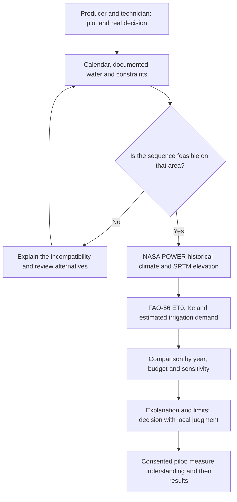

# Quasaris FarmTwin — Strategic, scientific and impact audit

**Date:** 15 November 2026, America/Lima.\
**Perspective:** critical mentoring for NASA Space Apps; it is not an official NASA evaluation nor an agronomic validation.\
**Version examined:** commit `3ddfaffa95a7313e090a6f273a1e24fb3936fc7e`, initially clean tree.\
**Authorised scope:** research, reading, reproduction and this report. The application, the engine and the datasets were not modified. The corrections described are proposals.

> Translated from the original Spanish. The findings describe the commit named above; later commits may have addressed some of them.

## 1. Executive verdict

**Quasaris has a useful basis for comparing irrigation demand under historical climate, but it does not yet justify recommending to a farmer what to plant.** The software's reproducibility is good; the validity of the agricultural decision remains open. Presenting it tomorrow as an explorer used together with a technician is defensible, with visible limits. Presenting it as a validated digital twin that predicts profits, soil health or real water savings is not.

The most decisive evidence is reproducible:

- The 36 Python tests pass; so do TypeScript, lint and build. The engine exactly reproduces the demo snapshot.
- The two default alternatives have incompatible calendars on the same hectare: **43 and 20 days of overlap**, respectively. The first requires 405 crop-days and the second 370 within a 365-day year. Changing only the dates does not fix the first.
- During the overlap, the engine keeps the higher daily Kc but counts income from all crops. Duplicating an alfalfa on the same plot raises the margin from S/11,000 to S/22,000/ha without increasing water demand. The ranking accepts that alternative.
- With the default values (sprinkler, sandy soil, 15,000 m³/ha/year), no rotation covers its median demand. The lowest-demand alternative needs 17,322 m³/ha/year and only fits the budget in 2 of the 21 simulated years.
- The modelled reduction against alfalfa is **1,030 m³/ha/year, 5.6%**, for that invalid alternative. It does not show achievable savings.
- The fallback can show results from another configuration as if they belonged to the current one. The snapshot declares `source.power="cache"`, so the warnings conditioned on `"mock"` do not identify it as a demo.

These results come from [rotation.py](../engine/rotation.py), [simulate.py](../engine/simulate.py), [engine-client.ts](../lib/engine-client.ts) and reproductions made in this audit, detailed in §2 and §15.

**The regional problem exists; the current framing oversimplifies the producer.** The [ANA documented planting restrictions due to water availability in 2015][S08]; [AUTODEMA documented drainage problems in B-3 in 2025][S10]. This does not show a uniform deficit nor a current allocation of 15,000 m³/ha for every farmer. Nor does it allow treating a livestock farmer with established alfalfa as if they could freely switch to vegetables.

**Strategic decision:** keep Majes as the territory, limit the pilot to producers with an annual area that is really available to change sequence, and work initially with a technician. The product should first answer: **"Does this sequence fit my field, my calendar and my water?"**

## 2. What Quasaris really does today

### 2.1 Evidence and scope of the inspection

We read `README.md`, `PLAN.md`, `CONTEXTO_RETO.md`, the three requested scientific documents and the calculation, contract, data, client, calendar, groupings, farm mode, maps, assistant, service worker, plan and deployment configuration modules. **`CHALLENGE_CONTEXT.md` did not exist; its equivalent was `CONTEXTO_RETO.md`.**

The interface evaluation is based on its components, texts and build; it does not include observation of farmers, touch tests on Android or a full interactive browser session. A GET request confirmed that the public endpoint `/api/py/health` answered 200 and declared Python 3.12.16. That does not verify the rest of the service nor show that production matches the local commit exactly.

An external simulation request was rejected by the automatic permission review because it exported local configurations to a public endpoint. It was not run nor attempted another way. The simulations were reproduced **locally**, with the repository's code and data. No notifications, messages or requests to the LLM provider were sent.

### 2.2 Inventory with evidence status

| Component | Observed evidence | Classification and limit |
| --- | --- | --- |
| Historical POWER | Four files, 2005–2025, seven variables; two cells take part in the base case | Implemented and reproduced. Not validated against a local station |
| FAO-56 ET0 | Vectorised functions, tests of examples 8 and 18 | Implemented and numerically tested; local accuracy pending |
| Altitude interpolation | SRTM and two-cell weighting | Implemented and algebraically tested; climate method not validated |
| Rotation comparison | Water, margin, soil index, risk and score | Implemented; default alternatives agronomically invalid |
| Time machine | Results per year and month, synchronised charts and maps | Implemented; replay of hypotheses, not observed yields |
| Calendar | Approximate cycles and weekly climatology; text warns it is not a forecast | Implemented; weekly calculation partly tested |
| Push alerts | Subscriptions, Blob, VAPID and daily cron | Code and configuration present. Real delivery and usefulness not verified |
| 3D farm mode | Allocation per tile, accumulations, scenarios and events | Implemented; mixes engine results with additional uncalibrated rules |
| Groupings | Compatibility, N, pests, roots and LER by rules | Implemented as a heuristic; no local agronomic validation |
| SoilGrids | Cached regional summary, quantiles, coverage and warnings | Implemented. Not a field-specific extraction nor a soil balance |
| MODIS NDVI / SMAP | NASA GIBS tiles | Visualisation. They do not feed water, yield or recommendations |
| Assistant | Tool calling, dictation, photo and changes to priorities/water | Implemented in code. Answers not evaluated in this audit |
| Offline | localStorage and service worker | Partly implemented; request–result matching is faulty |
| Printable plan | `window.print()` and summary by groups | Implemented; the PDF depends on printing/saving from the browser |
| SENAMHI | Comparison script and download procedure | Prepared; no CSV or local validation results found |
| Weather forecast, field-level HLS, collective water allocation | References in plans | Planned, not implemented in the current calculation |
| Use by farmers and impact | No documented records, interviews or trials | Not shown; this is not the same as claiming nobody has opened the app |

### 2.3 What was checked by running it

The `python` on the PATH was a Windows alias with no usable runtime. A portable Python 3.12.10 and dependencies were prepared in a temporary folder, without changing `requirements*.txt`. The Python dependencies have open lower bounds; today's installation does not represent a frozen production environment.

| Check | Result | What it shows |
| --- | --- | --- |
| `python -B -m pytest engine/tests -q -p no:cacheprovider` | **36 passed**, 1 Starlette/httpx deprecation warning | Numerical examples, contracts and covered behaviours |
| `npm run typecheck` | Passes | Static TypeScript compatibility |
| `npm run lint` | Passes | Configured ESLint rules |
| `node scripts/test-crop-calendar.cjs` | Passes | Existing calendar cases |
| `npm run build` | Passes; 45 pages generated | Frontend build and prerender |
| Base case `run(SimulateRequest(...))` | Exact match with `mock_simulate.json` | Reproducibility of the snapshot |
| Additional in-memory diagnostics | Overlaps, duplication, zero water, drip and fallback | Failures the existing tests do not detect |

**Passing tests shows conformity with those tests, not agronomic accuracy.** The fusion test checks that the weights add up to one and that the altitude is bracketed; it does not compare calculated temperatures with observed temperatures.

### 2.4 Reproduced results: model results only

Input: latitude −16.36; longitude −72.19; 2005–2025; soil `arenoso` (sandy); irrigation `aspersion` (sprinkler); **annual** budget 15,000 m³/ha; four priorities of 0.5; rotations from `data/rotations_majes.json`. The effective efficiency is `0.75 × 0.95 = 0.7125`.

| Rotation | Median gross water [p10–p90], m³/ha/year | Median margin [p10–p90], S/ha/year | Years with demand ≤ budget | Overlap |
| --- | --- | --- | --- | --- |
| Permanent alfalfa | 18,352 [16,577–19,144] | 7,712 [7,104–9,288] | 0/21 | 0 days |
| Onion · Potato · Forage maize | 19,318 [17,566–20,290] | 14,221 [11,312–20,277] | 0/21 | 43 days |
| Onion · Faba bean · Forage maize | 17,322 [15,453–18,167] | 19,496 [17,032–25,907] | 2/21 | 20 days |

These margins use assumed prices, costs, yields and penalties; they are not historical incomes in Majes. The same table does not allow forage used on the farm to be compared directly with money from a sold harvest.

When **only** the system is changed to drip, the median demands become 14,529, 15,293 and 13,713 m³/ha/year; they fit in 18/21, 8/21 and 21/21 years. This is a consequence of dividing by fixed efficiencies. It does not include investment, energy, maintenance or a uniformity check, and the alternatives keep their invalid calendars.

## 3. Alignment with the NASA challenge

### 3.1 What could be officially verified

The [official indexed summary of Field Shift][S01] asks for a tool that combines NASA observations, local soil information, crop characteristics and priorities to explore rotations that support soil health and adaptation. Quasaris is directly related to that goal.

The full official page and the submission/judging guides could not be fully downloaded because of access/TLS failures. The full text and its resources were reviewed in the [HackAthlone venue's copy][S02], which refers to NASA as the final authority. That copy uses optional language for comparing three strategies and for SI/AI, maps and other possibilities. **Do not turn those suggestions into verified official requirements.**

The scores, weightings and the particular Arequipa rubric were not verified. `CONTEXTO_RETO.md` is evidence of what the team believes will be judged, not of what NASA or the venue has published. The existence of the five usual categories appears on [a 2026 venue published on the official domain][S03]; it does not prove a specific global scale.

### 3.2 Evaluation of the product against the goal

| Dimension | Mentoring assessment, not an official score |
| --- | --- |
| NASA Earth observations | Substantive use: POWER changes ET0 and demand between years. SRTM takes part in the calculation. NDVI and SMAP are visual context |
| Local soil information | Weak integration: the manual texture changes efficiency; SoilGrids is shown alongside, without governing storage, salinity or suitability |
| Crop characteristics | Integrated: Kc, duration, thresholds and family. Traceability per parameter and sequence feasibility are missing |
| Farmer priorities | Sliders and profiles work. They do not represent mandatory constraints of forage, cash, contracts or calendar |
| Soil health | Interpretation by rules; not a simulation nor a validation of soil changes |
| Adaptation | Explores historical years and perturbations. It does not estimate a validated climate future |
| Impact | Relevant problem; beneficiary and change of decision not yet shown |
| Creativity | Historical replay and local interpretation can set it apart. An agricultural dashboard with AI is not enough |
| Validity | Good computational starting point; critical weaknesses in feasibility and calibration |
| Relevance | High for the general goal, conditional on improving the link with soil and real decisions |
| Presentation | Rich visual demo, but the story is too broad and risks overclaiming |

### 3.3 Submission: confirmed, pending and prudent

The [answer from a Navigator in `nasa/spaceapps`, discussion 1973][S04] confirms for 2026: a demo of up to 30 seconds or up to 7 slides, an explanation of the use of NASA data and AI, public access, submission in English or with English subtitles, and closing on **15 November at 23:59, local time**. The [indexed 2026 page][S05] agrees on the closing time. For Arequipa/Lima, work with America/Lima; do not assume that the local judging on the 16th extends that deadline.

Before submitting, a person must review the official guide/form available from their browser: required fields, licences, references, AI policy and local conditions. Full compliance with inaccessible guides is not certified. The public repository is good technical evidence, but it is not established here that it is the only acceptable format for the final link.

`docs/AI_USAGE.md` contains TODOs and model names that this audit does not authenticate. It must reflect what was really used, checked against the team's records, including generated images. A generated illustrative photograph is not fieldwork.

## 4. Evaluation against the mentor's framework

| Principle | Current situation | Evidence needed or correction |
| --- | --- | --- |
| Level 1: analysis | Reached as a computational prototype | Keep reproduction and provenance |
| Level 2: goal | Partial: comparing rotations is a task, but who can change what is not defined | Define the producer, available area and constraints |
| Level 3: impact | Not shown | Measure understanding, change of decision and then field results |
| Clear beneficiary | "Majes farmer" groups different systems | Choose a producer with a flexible annual plot, supported by a technician |
| Practical goal | The ranking gives an answer, but it can recommend impossible sequences | Feasibility before preference |
| Democratising NASA | Accessible API, Spanish and explanations are useful | Check understanding, connectivity and the units used locally |
| Scientific justification | ET0 is sound in its formulation; the later chain is weak | Separate equations, hypotheses and local evidence |
| Research/fieldwork | No documentation of real contact was found | Record agronomic review and genuine interviews |
| Process diagram | Pipeline documented | Show data → assumption → comparison → decision, with limits (§14) |
| Meaningful NASA use | POWER is essential; other layers do not change results | Explain each source's contribution without inflating its role |
| Bibliography | Useful initial documentation, many generic sources | Add date, table, units and scope per parameter |
| Functional AI | Can explain and adjust a scenario | Measure faithfulness; fix provenance and the associations contract |
| Responsibilities | `AI_USAGE.md` identifies areas, still to be confirmed | Assign human owners for data, agronomy, UX and pitch |
| English pitch | No final artefact was verified | Rehearse one decision and its limits, not a catalogue of screens |

This framework is a maturity guide, not three official NASA categories. Proving field savings within 48 hours is not required; distinguishing potential from observed impact is. Nor is there any reason to add AI agents if a deterministic explanation solves the same task.

## 5. The reality of farming in Majes

### 5.1 There is a documented problem, but it has several causes

The [ANA note of January 2015][S08] records a temporary recommendation not to plant high-demand crops and an agreed distribution of the regulated system. It shows that adjusting plantings to availability can be relevant; it does not establish the situation in November 2026.

The [ANA documented distribution, pressure and flow problems in 2019][S09]. [AUTODEMA reported drainage and seepage in B-3 in 2025][S10]. Annual availability, turns, delivery pressure and drainage are different constraints. An annual total per hectare does not by itself describe whether the water arrives when the crop needs it.

The relevant institutional set-up distinguishes the operation of major infrastructure and advice by AUTODEMA, administration/distribution by water user organisations, and the functions of ANA/ALA. The producer needs to check their specific delivery and schedule. Every distribution decision should not be attributed to a single institution, nor should a POWER pixel be assumed to represent the water of Condoroma or the Colca–Siguas system.

### 5.2 Alfalfa, milk and the real freedom to change crops

The [dairy production study published by UNMSM in 2001][S11] describes the alfalfa–forage maize–livestock link and experiences with feeding systems. It is historical evidence of that structure, not a current census.

The [INIA intervention in Majes in 2020][S12] confirms work with alfalfa, maize and the Users' Board. The [2023 municipal note about a dairy plant][S13] documents an organised chain of producers. Modelling the value of alfalfa only as the sale of tonnes is not defensible when it can feed a herd.

**Inference that requires interviews:** a livestock farmer may prefer stable forage, continuous milk and lower capital needs to vegetables with a higher apparent margin. Replacing established alfalfa also involves removal/establishment, transition, labour, equipment and market risk costs. The engine does not represent those costs nor animal nutrition.

The [2026 AGROIDEAS note][S14] documents conversion in the district towards grapes and a background of traditional crops. It does not justify extrapolating its profitability to all users. A vineyard or a contracted perennial crop is not area available for an annual rotation.

**Territorial distinction:** the Pampa de Majes/El Pedregal irrigation district is not interchangeable with the whole Majes or Aplao valley. Regional or valley sources must be delimited before transferring climate, soils, crops or population figures to the pilot.

### 5.3 Are 15,000 m³/ha and the chosen efficiency plausible?

The [2016 ANA/TNRCH resolution on block allocation][S15] contains background with different modules and volumes, including 13,500 m³/ha/year for certain areas pending incorporation and allocations measured at different points. It is historical background, **not proof of a field's allocation in 2026**.

As an arithmetic conversion, 15,000 m³/ha spread continuously over 365 days equals about 0.476 L/s/ha. That conversion does not include turns or losses and does not prove a right or actual delivery. What is needed: document/record, period, reference area, measurement point and monthly or per-turn schedule.

The efficiencies 0.45/0.75/0.90 are application hypotheses. Their generic plausibility does not validate the effective efficiency of an installation. The additional texture multiplier that lowers sprinkler to 0.7125 has no identifiable local source. Without gauging, uniformity and operating conditions, the comparison with the budget has unquantified uncertainty.

### 5.4 Soil, salinity and drainage

The repository's SoilGrids summary suggests a sandy texture for a large region, but it does not prove that all plots are equivalent. The drainage evidence in B-3 forces us to admit heterogeneity. A current prevalence of salinity across the whole irrigation district was not verified: **do not claim that all Majes soils are saline**.

The engine has no electrical conductivity, sodicity, water quality, water table, leaching requirement or drainage. [FAO-56, chapter 8][S19], covers relationships between available water, stress and salinity that are not implemented here. Saving gross irrigation without considering those processes does not guarantee better soil. [INIA offers soil, water and leaf analyses][S16]; the product can ease that conversation, not replace those analyses.

### 5.5 Information and advice that already exist

[AUTODEMA reported in 2024 that it had advised on irrigation automation since 2023 on about 14 plots][S17], using agroclimatic stations, Kc and scheduling. There is no basis for claiming that producers lack advice or that Quasaris is the first access to data for irrigation.

[AguaRiego, from the Nexus Institute/Purdue][S18], already allows crops and irrigation systems to be compared in Arequipa, including Majes. It is the most relevant functional precedent found. Its current adoption and operational availability on all devices were not verified.

**Defensible differentiation to build:** a year-by-year historical comparison of locally feasible sequences, with a documented budget and an explanation of constraints. Being more visual is not enough to beat an existing table that a technician already understands.

**Territorial conclusion:** Majes is a reasonable pilot for sequence and water decisions on flexible annual plots. The generic use "replace alfalfa with a more profitable rotation" is insufficiently justified. Changing region to hide that weakness is not recommended; selecting the use case and its population better is.

## 6. Scientific credibility audit

### 6.1 NASA POWER: resolution and meaning

[NASA POWER documents 0.5° × 0.625° for meteorology and 1° × 1° for solar radiation][S06]. Describing all inputs as one uniform cell of about 50 km is therefore incomplete. [The meteorological variables come from reanalysis/assimilation and represent the model grid][S07], not measurements of the field. The daily series is appropriate for exploring regional variability; it does not resolve internal microclimates.

Keeping 2005–2025 as an explicit historical sample is reasonable. The empirical distribution of those 21 years is not automatically the distribution of the next season, especially under trends, temporal dependence and changes in management.

### 6.2 SRTM and the "vertical fusion"

The calculation implements `w=(z_field−z_low)/(z_high−z_low)` and blends **all** variables between two cells. In the base case it uses elevations of 835.38 and 1,940.88 m, with weights of about 0.481 and 0.519 for 1,409 m.

**Defensible:** using elevation in the FAO-56 atmospheric pressure and as a covariate to investigate a temperature adjustment. [SRTM is elevation information, with products of about 30/90 m][S20].

**Not shown:** that choosing geographically different cells by their altitude corrects local humidity, radiation, wind, precipitation and extremes. Coast and highlands are not two stations on the same vertical profile. No calibration was found showing that the blend improves on the original cell.

In addition, `elevation.py:20` rounds coordinates to two decimals for caching: it can reuse one elevation between points about a kilometre apart. The cache granularity does not keep 90 m precision. If SRTM fails, the cell altitude is used; the response/UI does not clearly identify the origin of that altitude.

**Remedy:** call it an experimental adjustment, compare alternatives with a station and keep the option without adjustment as a baseline. Validate temperature before claiming that the adjustment improves frost estimates; do not extend a temperature correction to all variables without evidence.

### 6.3 FAO-56 ET0 and effective rain

[FAO-56, chapter 2][S21], supports Penman–Monteith as the reference method. `et0.py` implements its main terms, radiation and unit conversion; the published examples pass. Using mean RH to estimate vapour pressure corresponds to an approximation described in [chapter 3][S22]; the Brussels example passes `ea` directly and does not validate that specific path with POWER.

The engine calculates `ETc=Kc×ET0`, subtracts monthly effective rain and divides by efficiency. The conversion 1 mm = 10 m³/ha is correct. Effective rain uses a simplified USDA-SCS formula; **do not call it an FAO-56 equation** without a specific source.

There is no daily soil water balance, initial storage, runoff, drainage, irrigation by turns or deficit by stage. The demand is a planning approximation. The existence of a Hargreaves function does not mean it is an operational fallback: `compute_et0()` calls Penman–Monteith directly; the cleaning requires radiation and the other inputs.

### 6.4 Kc, stages and alfalfa against Purdue

Stage curves are a recognisable basis, but the dates always start on day 1 of the month and the durations do not change with variety, management or temperature. [FAO-56, chapter 6][S23], distinguishes stages, standard conditions and the effects of cuttings. A constant annual Kc of 0.90 can be a planning hypothesis, but it is not a measured local average nor enough to represent each cutting.

The PDF of [AguaRiego, table 11, numbered page 14][S18], was downloaded and read: for alfalfa it reports **10,701 m³/ha in 12 months**. The local documentation records 13,219 and +24%. The audited version returns 18,352 gross; multiplying by 0.7125 gives about **13,076 net**, that is **+22.2%** against that reference. The small rounding difference does not explain the distance from Purdue.

The comparison is **model against model**, with different inputs and assumptions. The documented explanation "probably because of constant Kc and humidity" is a hypothesis, not a proven attribution. It was not verified in the manual that its treatment of cuttings is exactly the one assumed by `VALIDATION.md`. Breaking down climate, Kc, cuttings and rain is required to explain it.

The current net p10–p90 is about 11,811–13,640 m³/ha: it does not include 10,701. The interannual range shown therefore neither covers nor shows that it has incorporated that discrepancy between methods. **Do not use the sentence in the document suggesting that showing a range already resolves this uncertainty.**

Local sensitivity, changing only `kcAvg` in memory:

| Assumed constant Kc | Median gross demand, m³/ha/year |
| --- | --- |
| 0.80 | 16,199 |
| 0.90 | 18,352 |
| 1.00 | 20,496 |

These are illustrative perturbations, not a confidence interval. The change of more than 2,100 m³/ha for ±0.10 in Kc exceeds the difference of 1,030 between the current alternatives. It has not been shown that the direction of the advantage survives parameter uncertainty.

### 6.5 Calendars and area accounting: critical defect

`place()` in [rotation.py:90](../engine/rotation.py#L90) takes the maximum Kc on shared days. [The economic accounting:156](../engine/rotation.py#L156) adds all crops at full area.

| Example | Occupation | Implication |
| --- | --- | --- |
| Income | 150 + 145 + 110 = 405 crop-days; 362 occupied days | 43 days of double occupation |
| Soil/water | 150 + 110 + 110 = 370; 350 occupied days | 20 days of double occupation |

In "Income", the 43 days break down into **23 potato–maize days in December and 20 maize–onion days in March**, because the maize continues into the following year. They are not 43 days only between potato and maize, as the README suggests. The editor warns, but the server and the ranking do not reject it.

The circular use of the calendar also evaluates a December sowing with January–March of the same replay year, not with the chronologically later days of the following season. It is a periodic annual approximation, not a continuous simulation of seasons nor an observed reconstruction.

**P0 remedy:** prevent an invalid sequential rotation from producing a recommendation. Do not "fix" the water by adding the Kc of crops that cannot share that hectare. Review duration, number of seasons or area; a real association needs another design and evidence.

### 6.6 Available water and "viable"

`simulate.py:83` defines `viable` as **annual median** demand ≤ budget. It does not evaluate minimum reliability, turns, delivery capacity or other constraints. `waterFit()` does count the years that fit and is better evidence for the user.

`rotation.py` splits the budget into 12 and marks monthly stress when demand exceeds 120% of that share. This does not automatically represent the real distribution. In farm mode, an annual capacity drawn as a reservoir and an accumulated demand do not prove physical storage or a real date of depletion either.

Use "compatible with the annual budget entered in X/21 historical years, under these assumptions" instead of "viable". If the budget is not documented, show a sensitivity and an incomplete-information status, without turning 15,000 into a confirmed local allocation.

### 6.7 Yield, costs and margin

`incomePEN` is a margin estimate: fixed yield × fixed price × factors − fixed cost. It is not gross income nor complete business profit. The "MIDAGRI Arequipa" references in `crops.json` do not identify tables, dates, variety, product presentation or management system.

The loss is calculated with 3% per frost day and 1% per heat day, with a floor of 30%; the water constraint also keeps at least 30% of the yield. No calibration by crop, stage, event duration or severity was found. With zero available water, alfalfa keeps **27 t/ha/year modelled** and gives a margin of −S/1,600, against −S/7,000 if there were no production. It is not validated that this production could be sustained with the rain/storage present.

With abundant water and no temperature events beyond their thresholds, the three margins are constant over the 21 years: S/11,000, S/31,700 and S/27,700. An economic interval that collapses to a point does not mean certainty: it shows that the model does not vary prices, costs, productivity or market.

Drip changes water and penalised yield, but does not add installation, energy or operating costs. The value of forage for milk is left out. **Remove profitability from the main recommendation role until the economic definition and inputs are validated.**

### 6.8 Risk: a percentage with the wrong meaning

`risk_by_year` takes the maximum of the estimated climate loss and the annual deficit fraction. The median of that value **is not the probability of frost, of loss or of failure**. In the base case, none of the three rotations records days beyond their cold/heat damage thresholds in the 21 years, yet alfalfa shows a median "risk" of 18.3%: it comes from the water deficit.

The Compare screen labels it "Climate risk". That is a material semantic mismatch. Separate the historical frequency of events, the size of the deficit and the hypothetical penalty. The calendar's climatology, with general thresholds of 2 °C and 30 °C, has a different definition; its UI already explains it correctly and that warning should be kept.

The score has no absolute meaning either: `simulate.py` normalises water and income among the alternatives present, combines weights and applies a factor of 0.6 to the option that exceeds the median budget. Adding another alternative can change the scale and the ranking even if the agricultural results of the previous ones stay the same. The deficit also influences margin and risk, so the four sliders are not independent dimensions. A "90/100" does not prove 90% reliability, suitability or success. Show the trade-offs and constraints before the score; do not use it as scientific evidence of superiority.

### 6.9 Soil and nitrogen

`soil_score()` adds points for legumes, families, perennials and roots, and subtracts points for bare months. It does not update carbon, nutrients, salinity, infiltration or erosion. A value of 0.80 does not show "80% health" nor a five-point improvement measurable in the field.

`evaluateGroup()` adds up the N demand and fixation from the crop records and shows `fixed−demand`. It does not represent removal at harvest, returned residues, mineralisation, nodulation, fertilisation or losses; in associations it does not make a physical balance by density/equivalent area either. A legume's ability to fix N does not guarantee a net contribution of that amount to the next crop, especially when forage is removed.

Keep the qualitative explanations of diversification and cover. Rename them as rule-based management indicators, not measured health nor a fertilisation plan.

### 6.10 Associations and intercropping

The model gives equal shares to each crop, averages Kc, increases it by 10% when they coincide and multiplies yields by a compatibility table. It is not a local empirical estimate of the Land Equivalent Ratio. The companion planting values and their penalties have no specific references per combination.

An association with real densities and spatial patterns is not equivalent to dividing a hectare into fractions and applying a bonus. Nor should it validate an impossible rotation by changing the mode selector. Keep it as a teaching exploration or remove it from the main demo until a local review.

### 6.11 NDVI, SMAP, SoilGrids and GWETROOT

- The [GIBS WMTS][S24] catalogue was queried directly: the layers used exist. The monthly NDVI uses `GoogleMapsCompatible_Level7`; it is not the 250 m MOD13Q1 series mentioned in the initial context. [NASA metadata links the monthly visualisation with MOD13A3/MOD13C2][S25]. Do not attribute 250 m resolution to this layer. Zoomed-in tiles add no new field-level information.
- SMAP L4 is a regional-scale model/assimilation product; [NSIDC documents a 9 km grid and three-hourly products][S26]. GIBS offers here a daily instantaneous 12z visualisation, not a sensor per farm tile.
- `smapDate()` turns dates before the mission into **2015-04-15**. The map can show 2015 soil when exploring 2005; it should say "no data for this date". `ndviDate()` replaces April 2025 with May without explaining the substitution. The catalogue confirms the April gap and also SMAP gaps.
- [SoilGrids offers 250 m predictions with uncertainty][S27]. `getMajesSoilGridsReference()` returns the same summary of 8,906 cells for any point inside the AOI. The regional median of per-pixel quantiles is not the field's prediction interval nor the confidence interval of the regional mean.
- [POWER distinguishes wetness from volumetric content][S28]. Showing `GWETROOT≈0.33` as "33% soil moisture" does not prove water available to the roots, dryness of the field or an immediate need to irrigate. The 0.4 threshold in the code has no local calibration. The value does not enter the balance and does not demonstrate the claim "without irrigation the soil stays dry" through a counterfactual experiment.

### 6.12 Future scenarios and 3D

`scenarioYear()` selects historical years by alfalfa demand: median, maximum or a year from an ENSO list, excluding the maximum so the options are different. "Year of highest demand" is not necessarily the same as a hydrological drought or lower delivery. The ENSO selection does not validate a causal local response nor probabilities for the next season.

Adding +1.5 °C to Tmax/Tmin is a sensitivity test, not a regional projection with a horizon and an emissions scenario. The 3D view distributes results by crop/area; it does not resolve observed humidity, wind or soil for each tile.

There is also additional scientific logic in [granja-sim.ts](../lib/granja-sim.ts): it penalises again economic results already affected by water; multiplies the net margin by damage, implicitly altering costs; splits crop income into equal shares and applies damages listed in `granja-events.ts`. The results can differ from the comparator for reasons the user does not see. "Everything uses the same engine" is not enough as a guarantee of consistency.

### 6.13 Quality, provenance and uncertainty

The cleaning recognises sentinels, ranges, coherence and gaps: it deserves to be kept. In the two cells of the base case, no data or years were discarded. That does not show the absence of bias.

Pending aspects:

1. The temperature outlier filter against the whole month can suppress real extremes; not every rarity is an error. Traceability and validation of events are needed.
2. Rain and GWETROOT are not part of `CORE` when excluding years. If all years were bad, `get_climate()` keeps them; `quality` and `excluded_years` are not passed on in `Source`. The user does not receive that warning.
3. `_nearest_cached()` does not limit distance: without neighbouring data it could fall back to Majes for another region. The cell metadata exists, but an accepted domain and an explicit non-representativeness status are missing.
4. The POWER cache keeps values and basic metadata, but not the full original payload, version, download date, units and provenance hash. [NASA warns that the POWER archive is updated][S06].
5. p10–p90 represents variation between years with the same parameters. It does not include climate error, Kc, efficiency, dates, prices or model structure, nor is it a confidence interval for the savings.

### 6.14 Assistant, contracts and offline

The assistant's instructions require tools before figures and distinguish models from observations. It is a useful safeguard, but a prompt does not guarantee faithfulness nor eliminate hallucinations.

Two specific failures:

- [engine-client.ts:9](../lib/engine-client.ts#L9): `simulateMock()` keeps the snapshot's `source` (`cache`), filters by id and only recalculates `viable`. It can present the water and margin of alfalfa under the name of an edited rotation that keeps that id. The assistant only suppresses score/evidence when `power=="mock"`; that condition is not met in this fallback.
- [tools.ts:23](../app/api/chat/tools.ts#L23): the Zod rotation schema does not contain `mode`. Validation removes that field and an association can reach the backend as a sequential rotation, diverging from the comparator.

The second case was confirmed locally by loading the real schema: an input with `mode="association"` came out of the parse without the `mode` field. It was an in-memory contract test, without calling the LLM.

Local diagnosis of the fallback: a request with a custom crop, coordinates 0/0, drip and zero water, with the network simulated as down and a previous Majes result. `simulate()` returned the three original rotations and 18,352 m³/ha for alfalfa labelled `cache`. No network was queried during that diagnosis.

The useful offline promise is **to look up a previously calculated result for the same inputs**. Do not promise to recalculate new scenarios without the engine. The calendar already caches by coordinates: that is a more prudent implementation, although its climate response still lacks full quality metadata.

## 7. Usefulness analysis for the farmer

### 7.1 Which task deserves to exist

The minimum value flow is: **enter an area that can really change crops, recognise the constraints, compare the current sequence with plausible options and see what prevents or favours them**. It should end in a question the farmer can resolve with their technician or their irrigation organisation, not only in a score.

The current interface offers a four-step wizard, Spanish, explanations, compared results and a printable plan: it reduces friction. However, it assumes knowledge of m³/ha, uses alfalfa as the starting situation and offers a default figure when the user does not know their water. It does not first ask whether they have an annual plot, must feed livestock, have a contract or can finance a transition.

The six main tabs, 0–100 indicators and zoomable maps create cognitive work that has not been measured. The root `/` redirects to `/en` in `next.config.ts`, although the README declares Spanish as the default. It is a reversible detail of local access, less serious than the validity of the calculation.

### 7.2 Hypothetical scenarios, not interviews

The following cases are design exercises based on plausible constraints. The areas and situations illustrate decisions; they are not observations and do not represent a sample of Majes.

| Case | Authentic decision | Current contribution of Quasaris | Missing information | Reason to come back |
| --- | --- | --- | --- | --- |
| Livestock farmer with 5 ha and alfalfa established for the herd | Keep enough forage and decide what fraction of a plot due for renewal could go to another sequence | Order of magnitude of demand and historical comparison | Feed requirement, dry matter, quality, cuttings, forage purchases, age of the alfalfa stand, milk, renewal costs and delivered water | Today, weak for recommending a change. Could come back with their technician if the system keeps a minimum of forage and compares a really available fraction |
| Onion grower with 1 ha of annual crop, limited capital and a sales window | Choose a second crop that ends before the next sowing and whose demand peak can be met | Calendar and water per month/year help discuss options | Variety, real days, preparation between crops, labour, inputs, buyer, dated price and delivery calendar | Plausible before each season if the comparison is valid and keeps its constraints |
| Producer with 2 ha and irregular delivery due to pressure/flow | Know whether the constraint is water delivery, management or crop choice before investing | Can show theoretical demand and reveal missing data | Gauging, hours/turns, pressure, uniformity, storage and drainage; the current model does not diagnose them | Today, a weak reason. Would come back to review a documented schedule with the technician, not because the map diagnoses their installation |
| Producer with established grapes and a commercial commitment | Evaluate management of an existing perennial, not replace it with an annual rotation | The current product adds little to their main decision | Perennial phenology, contract, real irrigation, management and investment | Not the recommended initial beneficiary |

The second case is the best immediate fit. The first is important in Majes, but requires keeping the livestock–forage link; the third shows that "lack of water" is not always fixed by changing crops. The fourth marks a useful boundary of the product.

### 7.3 What to keep and what to simplify in the experience

- **Comparison:** keep water and calendar in view; show unmet constraints before the winner. The score should not hide an impossibility.
- **Time machine:** keep it as evidence of interannual sensitivity, with the sentence "this is what the model would have calculated with that climate and these assumptions". Not "what your farm would have earned".
- **Calendar:** useful for seeing occupation and preparation; it should not hide incompatible crops by showing only the one with the highest Kc. Keep the current warnings about climatology and approximate dates.
- **3D:** can ease learning or explain spatial allocation. No evidence was found that it improves the decision compared with a simple comparison. Move it to a secondary route and evaluate whether it justifies its load on a low-resource phone.
- **Assistant:** focus it on "explain this difference", "what data am I missing" and "what changes under this budget". Photos and voice require independent evaluation; describing an image does not validate the agronomy.
- **Connectivity:** allow looking up the last identified comparison with its date, inputs and version. Prohibit presenting new inputs as recalculated if a previous result is kept.

Retention should match real moments of planning or water review. There is no need to invent a reason to open a pre-season decision tool every day.

## 8. Main weaknesses and misleading assumptions

**Severity scale:** critical = can invalidate the recommendation or attribute data to the wrong situation; high = can change a relevant decision or a scientific claim; medium = limits interpretation/use and can become high if exaggerated.

| Weakness | Severity | Evidence | Consequence | Recommended remedy |
| --- | --- | --- | --- | --- |
| Impossible calendars and double counting | **Critical / P0** | §6.5; 405 and 370 crop-days; duplicate diagnosis | A winner may not be growable nor have the margin shown | Mandatory server-side validation; exclude from ranking; review examples with an agronomist |
| Fallback from another configuration and a demo labelled `cache` | **Critical / P0** | §6.14; offline diagnosis | The user or the AI attributes results to another field, rotation or budget | Request identity, version and provenance; explicit demo; prevent a new recommendation without a valid calculation |
| Beneficiary without forage/contract/capital constraints | **High / P0 for positioning** | §5 and §7; those fields do not exist | Impractical recommendation even if the water were right | Limit to a flexible annual area; ask for mandatory constraints |
| 15,000 m³/ha treated as the farmer's own water, enough to decide | **High / P0** | Estimated default; no alternative fits at the median | An example scenario is confused with real delivery | Explicit annual period, source and delivery point; if missing, show a hypothetical comparison |
| "Climate risk" mixes deficit and loss | **High / P0** | §6.8; 18.3% with zero threshold events | Misinterpretation as a probability | Rename/separate size and frequency; explain the denominator |
| Margins without local prices/costs or economic uncertainty | **High / P0 for claims** | `crops.json`; zero water; drip without investment | Misleading profits and returns on investment | Label as a hypothetical margin; avoid economic decisions; review parameters and costs |
| Adjusting all variables by elevation alone | **High / P0 for claims; validation P2** | §6.2; no SENAMHI | Apparent precision of water and extremes | Declare it experimental and compare with stations before claiming an improvement |
| p10–p90 presented as total uncertainty | **High / P0** | §6.4 and §6.13 | A narrow range can create unjustified confidence | Say "historical variability with fixed parameters" and list the remaining uncertainty |
| Soil/N and LER that look like measurements | **High if prescriptive / P0 for labels** | §6.9–6.10 | Unsupported fertility, fertilisation or soil improvement | Qualitative rule-based indicators; no available kg nor measured health |
| Mismatch between farm, comparator and assistant | **High / P0 if in the demo** | Repeated economic penalty and `mode` removed | The same question gets incompatible figures | Demonstrate a single calculation; fix the contract and accounting before using those routes |
| Future confused with replay, and an illustrative annual reservoir | **High if a forecast is promised / P0** | §6.12 | Drought/depletion date without support | Identify the year and the perturbation; avoid operational alerts based on analogy |
| Substituted image dates and mixed scales | **Medium-high / P0 if shown as evidence** | §6.11 | Apparent observation of a year/parcel that does not exist | Visible effective date, absence of data and correct resolution/product |
| Lack of validation of climate, management and understanding | **High / P0: declare; P1/P2: measure** | No local results were found | The precision of recommendations is not defensible | Short understanding trial and a pre-registered scientific roadmap |
| Navigation complexity and 3D load | **Medium / P1** | Inspection of components; no users | Can hinder the task in the field | Comparative test of a simple flow and 3D; prioritise the one that helps |
| Regional quality/fallback without transmitted limits | **High outside the pilot / P0: restrict scope** | §6.13 | Silent extrapolation to unrepresented areas | Reject out-of-domain requests if there is no valid data; transmit QA and the effective source |
| Incomplete documents and AI declaration | **High for credibility/submission / P0** | TODOs and the 13,219 vs 13,076 discrepancy | A judge cannot trace the claims | Reconcile documentation with the audited version and real records |

## 9. Existing strengths worth keeping

1. **Separation between a deterministic engine and the LLM.** It allows calculations to be audited and keeps the AI as an interpreter. Fallbacks and contracts must be fixed to keep that promise.
2. **POWER data included and a reproducible case.** The results do not depend on generating narrative figures in the interface; the snapshot matched the engine exactly.
3. **ET0 with reference examples and coherent units.** It is the part with the best methodological support; it does not need to be replaced with AI.
4. **Variability by year and month already calculated.** It allows budgets and comparisons to be explained without adding another dataset right away.
5. **`waterFit()` and per-year traces.** The empirical frequency of budget compatibility communicates more than a median-based "yes/no".
6. **Calendar texts that acknowledge limits.** They distinguish history, general thresholds and approximate demand from an operational instruction. Extend that standard to the rest of the product.
7. **Warnings and expert review already in place.** There is infrastructure to make the unknown explicit; it should appear at the moment of deciding.
8. **Spanish, printable plan and local persistence.** They can ease supported work and limited connectivity; their usefulness must be checked with people.
9. **Ability to demonstrate a real flow that builds.** The technical ambition is already enough for the demo. The bottleneck is scientific and one of focus.

## 10. Impact model and measurable indicators

### 10.1 Separate four levels of evidence

| Level | Admissible claim | Quasaris status |
| --- | --- | --- |
| **A. Technical output** | The model calculates a demand and a difference under declared inputs | Shown for reproduced cases; some scenarios are invalid |
| **B. Decision-support outcome** | A person understands the difference and identifies what limits their decision | Not measured |
| **C. Potential impact** | A feasible decision could reduce withdrawals, exposure to deficit or planning errors | Hypothesis; requires local conditions |
| **D. Demonstrated impact** | Applied water, margin or another result was measured after acting, with an adequate comparison | No evidence provided or found |

The figure of 1,030 m³/ha/year belongs to A, and its calendar must also be invalidated/reviewed before using it as a candidate for C. It does not belong to D. The 5.6% does not allow a promise of "20% savings" either; the `save20` medal is a game condition, not an achieved result.

### 10.2 Indicators with definition and status

| Indicator | How to measure it | Status and limit |
| --- | --- | --- |
| Modelled difference in demand | For each year, `W_current(y)−W_alternative(y)`; then the median and distribution of those paired differences | Today there are only figures for invalid alternatives. A difference of medians is not always the median of differences |
| Historical annual compatibility | Years with demand ≤ budget / valid years; report both integers | Reproduced: 0/21, 0/21 and 2/21 with defaults. Not a future guarantee |
| Delivery compatibility | Months/turns with demand that can be met considering delivery and storage | Not implemented nor measured |
| Sensitivity of the comparison | Repeat with documented ranges of Kc, efficiency, dates and budget; detect changes of sign/winner | Illustrative Kc diagnosis in §6.4; not calibrated uncertainty |
| Frequency of temperature events | Number of years with a defined event during relevant stages / valid years | The current model uses simplified thresholds; validate against observations |
| Economic difference | Margin with dated local prices, costs and yields and a sensitivity analysis | Do not use the climatic p10–p90 as market risk |
| Understanding | People who identify the budget, the non-viable alternative and the historical meaning / participants | No initial measurement |
| Time to compare | Time to a correct answer in a defined task; report the median and errors | Not measured; do not measure clicks only |
| Reach | Real participants who complete a comparison, with consent and a user definition | No verifiable record was found |
| Pilot hectares | Area of eligible participating plots, without duplication and with authorisation | Not documented; do not use the map's extent as area served |
| Real applied water | Gauge/meter × duration, normalised per ha and season; compare against a relevant baseline | Not measured by Quasaris |
| Observed yield and margin | Weights/sales, full costs and forage use, with date and comparison | Not measured by Quasaris |

### 10.3 How many could benefit

There is no verified denominator of eligible farmers, flexible hectares or support capacity. **A figure for potential pilot beneficiaries cannot be defended today.** Nor should families from an institutional note be turned into Quasaris users or partners.

The estimate must be built from a consented register:

`potential beneficiaries = producers in the area × fraction with an eligible decision × viable access to the service`.

`usable hectares in the pilot = sum of the flexible annual area of participants who agree to try it`.

To scale, use observed adoption and retention, not invented percentages. A technician or organisation can facilitate several comparisons; their capacity and willingness must be checked first, without presenting it as an agreed partnership.

A reduction in gross demand or water applied on a field is not automatically a consumptive saving at basin scale either: evapotranspiration, return flows, drainage and reallocation matter. Publish the unit and the measurement point separately.

## 11. Improvement opportunities ordered by value and feasibility

The hours are mentoring estimates for a person familiar with the code; they are not commitments nor a record of available time. The date of this audit coincides with the published closing day. Prioritise one verifiable flow and its explanation, and do not try to complete the whole roadmap tonight.

| Order | Proposed change | Value for the farmer / challenge | Estimated effort | Risk and priority |
| --- | --- | --- | --- | --- |
| 1 | **Mandatory feasibility filter before the ranking**; exclude invalid calendars and review three candidates | Avoids advising an impossible sequence; strengthens the core of the challenge | 2–4 h software; agronomic review depends on availability | Low-medium if invalid ones are rejected; **P0** |
| 2 | Fix cache/fallback identity and the demo source, and prohibit a new recommendation with an old calculation | Avoids false confidence with poor connectivity and AI | 2–4 h | Medium because of several clients; **P0** |
| 3 | Make the water period/source, gross demand and X/21 years explicit; if the allocation is missing, show only a scenario | Turns the result into an interpretable comparison | 1–3 h | Low if calculations are reused; **P0** |
| 4 | Fix the labels for risk, margin, soil, replay and the effective date of images | Reduces misleading claims immediately | 1–2 h | Low; **P0** |
| 5 | Choose a single eligible case and produce the demo/pitch with evidence and limits | Explains the goal and the potential impact | 1–2 h plus team review | Low; **P0** |
| 6 | Align `mode` and accounting between comparator/assistant/farm or limit the demo to the consistent flow | Avoids visible contradictions | 1–3 h for the contract; 3D accounting may need more | Medium; **P0 if shown** |
| 7 | Short review with an agronomist and an understanding test with available farmers | Provides decision evidence and detects unrealistic assumptions | 20–30 min sessions plus analysis; uncertain recruitment | Low, with consent; **P1** |
| 8 | Two or three parameter sensitivity scenarios, clearly hypothetical | Reveals whether an advantage is robust | 2–4 h if the engine is reused; additional scientific review | Medium; **P1** |
| 9 | Move 3D and associations to a secondary path; initial access in Spanish | Reduces friction and clarifies the purpose | 1–3 h | Low; **P1** |
| 10 | Calibrate climate and water, local economics and decisions with follow-up | Makes the service defensible beyond the hackathon | Weeks and at least one season for agricultural results | High if simplified; **P2** |

**Do not prioritise now:** more agents, sensors, indices, an extra dashboard, pest prediction, another map layer, collective optimisation or a large crop model. Each addition adds validation dependencies without resolving the current accounting and use case.

An unspectacular but valuable improvement is to allow the status **"with this information a choice cannot be made"** and return two specific missing data points. Not every query needs a winner.

## 12. Immediate implementation priorities

This section proposes later work. None of the following was implemented during the audit.

### P0 — Essential before presenting a recommendation

1. **Block incompatible calendars in the engine and exclude them from the ranking.** The editor's warning is not enough. Review area, sequence, preparation between seasons and year crossing. Avoid duplications; keep associations as a separate mode. Closing criterion: the duplicated case produces no recommendation and the demonstrated examples have a justified chronology.
2. **Restore the match between inputs and results.** Store a request fingerprint and version with the result; identify when it is a demo, a valid cache or an outdated result. Changing water/crops offline should produce "no new calculation", not silently keep figures. Include the assistant's fallback.
3. **Show the budget and the indicators honestly.** Year/season, m³/ha/year, delivery point, assumed efficiency and X/N years. Hypothetical margin, rule-based management index and historical sensitivity; no figure presented as an observation or a forecast.
4. **Declare what is not validated and restrict use.** Budget, economic parameters, local curves and climate fusion are still pending. Do not claim SENAMHI validation, "AI without hallucinations", measured soil health or achieved savings. Suspend recommendations outside the scope if only the Majes cache exists.
5. **Close the submission evidence.** Review `AI_USAGE.md`, document sources per result, public links, one reproducible case and the official guide from a human's browser. Verify that the flow shown uses the correct inputs and source.

**If only 1–2 hours remain:** do not create another model nor rework the whole UI. Remove invalid alternatives from the story and the ranking, identify the demo as exploratory and prepare a traceable base case. If the alternatives cannot be reviewed, explain that limitation without promising rotations ready to plant. The suggestion to show three comparisons does not justify inventing three agronomic calendars.

### P1 — Valuable if there is time and real access to people

- Review two candidate sequences with a technician, keeping the participant's real current crop. Do not assume it must be alfalfa nor change durations just so they fit.
- Measure understanding and time with the §13 protocol, storing answers, errors and the app version.
- Present a simple budget/efficiency sensitivity and withdraw the winner if it changes under plausible unresolved assumptions.
- Make the semantics of the calendar/alerts and the other screens uniform. The annual budget is not a weekly irrigation order.
- Ensure initial access in Spanish, a short plan and a readable comparison on a phone; 3D optional.

### P2 — Later development and real validation

- Temporal balance of deliveries, storage and soil only if the use case requires it and there is data.
- Calibration with stations and independent validation of demand/irrigation; traceable local agronomic records.
- Economics of the production system, including forage and transition costs; evaluation of associations through a specific trial.
- Follow-up of decisions, adoption, applied water and observed margin during a season.
- HLS or other field-level evidence only when a question is formulated that cannot be answered with the current inputs.

## 13. Scientific and field validation roadmap

### 13.1 Cheap and quick experiment: does it help understand a decision?

**Proposed design, not yet carried out:** recruit five farmers with eligible annual plots and two technicians/agronomists, without promising them a productive recommendation. A session can be held with an existing organisation only if it agrees to collaborate; do not declare that collaboration before obtaining it.

1. Record the current case, the known or unknown budget, constraints and the pending decision. Ask for consent and anonymise the shared results.
2. Ask the technician to review the two alternatives and the calendar before showing them. If none is feasible, use that conclusion as a valid result of the exercise.
3. Give an identical task with a simple table/summary and with the comparator; alternate the order between participants to reduce learning effects. Do not require real changes in planting.
4. Ask: "Which one fits the water indicated?", "What data is missing?", "Does this predict next year?", "Why can one option not be planted like that?". Measure correct answers, time, help required and potentially harmful errors.
5. Show a hypothetical variation of water, for example −20%, explaining that it is a stress test. Check whether they distinguish a recalculated change from a saved result.
6. Ask what decision they would take next and what they would confirm with their technician. Document the intention as an intention, not as an action or a saving.

**Proposed iteration criterion:** aim for at least 4 of 5 correct answers in the critical task and no serious interpretation error among the participants. It is an internal usability target, not a population estimate nor a statistical validation. With five people, report integers, errors and context; do not proclaim general effectiveness.

It needs a phone, a prepared case, a record sheet and participants' time. Compare 3D against the summary only if a design question remains open; do not make them go through every feature to confirm that "they liked it".

### 13.2 Climate validation: weeks, not a figure for the slide

- Obtain authorised series from SENAMHI/AUTODEMA, with station metadata, coordinates, elevation, relocations, instruments, units and reading time. The [SENAMHI station map][S29] is an access point, not evidence that the download has already been done.
- Confirm the identity and historical location of Pampa de Majes: there are references with different coordinates/altitudes. Do not mix a conventional station, an automatic one and a historical table without checking.
- Compare the original cell, the lapse-rate adjustment and the current blend using the same dates. Report bias, MAE, RMSE and extremes by season; do not choose the method only by an annual average.
- Separate a fitting period from an independent test period. Keep the missing data and check sensitivity to the extremes filter.
- The current script calculates Hargreaves ET0 on both sides from temperature. That helps evaluate temperature and its transformation; **it does not validate radiation, wind, humidity or Penman–Monteith**. Those components need suitable observed variables or independent references with declared limits.

### 13.3 Agronomic and water validation

First build a record per crop: variety, use, observed duration, sowing/harvest, cuttings, irrigation system, Kc and source, yield and unit. Then compare the model with an independent reference configured equivalently; Purdue/CROPWAT is a comparison of methods, not a measurement.

For a field pilot, agree in advance what will be observed on volunteer plots during at least one season: gauge or meter, duration and turn, rain, area actually irrigated, dates, yield and management. Record estimated demand and applied water separately; a farmer who applies more water does not show that ETc is underestimated.

Do not reduce irrigation experimentally just to show savings. The productive trial and its criteria must be approved by the people responsible for the crop. If comparing with a previous season, adjust for or at least describe climate, area and management; prefer comparable plots when feasible. An isolated before/after does not identify causality.

Set error tolerances and rejection criteria **before** seeing the results, with the agronomist. Do not adopt an arbitrary percentage as a universal proof of accuracy. If the uncertainty of demand is greater than the advantage between two strategies, return "not distinguishable with the available evidence".

### 13.4 Economic and adoption validation

Obtain prices actually received, season costs, labour, water/energy, financing, investment and relevant depreciation. Distinguish product sales, forage used on the farm and the effect on milk. Test price, yield and transition scenarios, without calling a value without a justified distribution an "expectation".

Record who completed a comparison, who came back for a new decision and why. Distinguish access facilitated by a technician from autonomous use. Check usefulness against current practice, which may be technical advice or an existing table. Commercial viability and the cost of support/data are still questions, not achievements.

### 13.5 Proposed responsibilities

The member table in `AI_USAGE.md` requires confirmation by the team. To close the evidence, clear responsibilities are needed, even if one person covers more than one:

| Human responsibility | Verifiable deliverable |
| --- | --- |
| Science and data | Record of sources, parameters, stations, biases and limits of the version |
| Engine/backend | Feasibility, area/water invariants, contracts and tests for critical errors |
| Frontend/offline/assistant | Matching of inputs, source states and consistency of figures |
| Local research | Consents, agronomic review, cases and record of genuine sessions |
| Presentation/submission | English, demo, references, AI disclosure and review of links/deadlines |

An agronomist or an institution cited as a possible reviewer **is not part of the team nor a confirmed partner** without their express participation.

## 14. Recommended positioning and English pitch

### 14.1 One decision, one population and one goal

**Problem:** when planning an annual plot in Majes, a producer can compare alternatives whose calendar or demand does not fit their resources, while regional climate information requires technical interpretation.

**Primary beneficiary:** a producer in the Pampa de Majes irrigation district with annual area available to change sequence, initially supported by their technician. Not every farmer, livestock farmer or fruit grower in the district.

**Measurable goal:** allow the current sequence and reviewed alternatives to be compared, incompatibilities to be recognised, and the number of historical years in which their annual budget would have covered the modelled demand to be understood. The reduction in applied water is a later hypothesis, not a metric already achieved.

**Central demonstration:** a 1 ha case clearly identified as an example; visible date/period and provenance of the budget; sequence and calendar; historical demand and years that fit; a constraint that explains why it cannot be recommended. A change in the budget must recalculate or say that no new calculation is available.

**Essential NASA data:** POWER provides climate for ET0 and interannual sensitivity. SRTM provides elevation and an experimental adjustment that must be declared. MODIS/SMAP are not needed to demonstrate the current decision and should not be presented as validation of the result.

**Strong evidence:** FAO examples, reproduced test suite, identical snapshot and annual traces. **Limits to mention:** regional resolution, pending calendars and parameters, no field validation, incomplete uncertainty and no forecast.

### 14.2 Short pitch suited to the current state

> Farmers in Majes need crop plans that fit their land and water. Quasaris replays NASA POWER weather to compare modeled irrigation demand across historical years. Our prototype exposes trade-offs and missing information, but its example calendars still need agronomic review. We have reproduced the calculations; we have not demonstrated field water savings. Our next step is a locally reviewed comparison with farmers and technicians.

This text deliberately acknowledges the current state. Do not use a version that claims validated calendars, producers served or water saved until that evidence exists. Rehearse it out loud and adjust its length to the demo limit; do not assume any text fits just because of its word count.

### 14.3 Visual script for 30 seconds

| Approximate time | What to show | What the judge should understand |
| --- | --- | --- |
| 0–5 s | The target producer/case and a one-hectare decision; an illustrative image, labelled, if used | Who it helps and what they decide |
| 5–15 s | Comparison and calendar occupation, with budget and source | An alternative must be feasible before it competes |
| 15–23 s | One result per year and a budget change that is really recalculated | NASA data changes the analysis; history is not a forecast |
| 23–30 s | Evidence, the main limit and the next test | Reproducible software; field impact still pending |

If the failures have not been fixed yet, record the exploratory nature and the detection of incompatibility. Do not simulate a fix that does not exist. For the extended link, prepare evidence of configuration, equations and the understanding test if it can be carried out.

### 14.4 Recommended process diagram



The filter and the pilot in the diagram are the recommended design; **the mandatory filter does not yet exist in the audited version**. Prices and the soil index should not appear as satellite measurements in this flow. The AI, if used, explains results between G and H; it does not invent data nor validate the decision.

## 15. Evidence, sources and citations

### 15.1 Local reproduction and data fingerprints

Commands run: `npm run typecheck`, `npm run lint`, `node scripts/test-crop-calendar.cjs`, `npm run build` and `python -B -m pytest engine/tests -q -p no:cacheprovider`, the last one with the temporary portable executable. No mocks were regenerated and `npm run mock` was not run.

Test runtime: Python 3.12.10; NumPy 2.5.4; Pydantic 2.14.3; FastAPI 0.163.1; pytest 9.2.0; Node 26.13.1; Next 16.4.6. Installing the current versions allowed by the requirements made it possible to test this environment, not to certify every admitted combination nor the deployment.

Minimal example to repeat the base case and check the snapshot, in a Python environment with the declared dependencies:

```python
import json
from pathlib import Path
from engine.schema import SimulateRequest
from engine.simulate import run

root = Path.cwd()
rotations = json.loads(
    (root / "data/rotations_majes.json").read_text(encoding="utf-8")
)["rotations"]
request = SimulateRequest(
    lat=-16.36, lon=-72.19, soilTexture="arenoso",
    irrigation="aspersion", waterAvailableM3ha=15000,
    priorities=dict(water=0.5, income=0.5, soil=0.5, risk=0.5),
    rotations=rotations, locale="es",
)
result = run(request)
snapshot = json.loads(
    (root / "data/mock_simulate.json").read_text(encoding="utf-8")
)
assert result.model_dump(mode="json", exclude_none=True) == snapshot
for r in result.rotations:
    print(r.id, r.water.median, r.income.median,
          sum(y.waterM3ha <= 15000 for y in r.byYear), len(r.byYear))
```

The pilot point uses a cached elevation of 1,409 m and the included cells. It does not require querying the public endpoint. For the diagnostics, inputs were changed in memory: drip; water 0 and 100,000; and a rotation with two identical alfalfa entries. For the Kc sensitivity, a copy of the catalogue was used with `dataclasses.replace()` and `unittest.mock.patch()` inside the process; the JSON files were not edited.

| File | SHA-256 |
| --- | --- |
| `data/crops.json` | `2f3630afdbe667ac0c76f42dd5df8af5973a01280df511f109b183002e30071d` |
| `data/rotations_majes.json` | `cb12046b433eaa342d6a37ad3fdeec8048671e13aff51d7ca4eeae6377299495` |
| `data/mock_simulate.json` | `8510d70960dfdd1402773e8f0b76a1decfe6f1002c842c4d037574804e4bb12f` |
| POWER `-16.0_-71.875_2005_2025.json` | `c866216421f0c1baffe35e081071e1dcc0e1b747b1ee19a230f8251aefefcf4b` |
| POWER `-16.0_-72.500_2005_2025.json` | `f855c9dbd498e97ea3c5fa5dc2f963a56c16ff14ab0ea03d8346d7d7e78cd88b` |
| POWER `-16.5_-71.875_2005_2025.json` | `b87d7dfaa7c63e0ece90ec3f1481c2e92e4ca308cf04989cee8625166fa13c7b` |
| POWER `-16.5_-72.500_2005_2025.json` | `62a6d84abed8bd0080ec65ed0abf129b9cec03ae47960f3f07a3b88b41f77cf2` |

Main inspection points:

- [Rotation engine and accounting](../engine/rotation.py), [orchestration and score](../engine/simulate.py), [climate and geographic fallback](../engine/power.py), [elevation](../engine/elevation.py), [ET0](../engine/et0.py), [quality](../engine/quality.py).
- [Python contract](../engine/schema.py), [TypeScript contract](../lib/contract.ts), [numerical tests](../engine/tests/test_engine.py), [contract tests](../engine/tests/test_contract.py), [quality tests](../engine/tests/test_quality.py).
- [Crops](../data/crops.json), [rotations](../data/rotations_majes.json), [snapshot](../data/mock_simulate.json), [SoilGrids summary](../data/soilgrids/majes.json).
- [Client/fallback](../lib/engine-client.ts), [simulation hook](../lib/use-simulation.ts), [assistant and schemas](../app/api/chat/tools.ts), [prompt](../app/api/chat/route.ts), [farm mode](../lib/granja-sim.ts), [grouping heuristics](../lib/grouping.ts).
- [Calendar](../lib/crop-calendar.ts), [comparison](../app/[locale]/comparar/comparar-client.tsx), [map sources](../lib/gibs.ts), [alerts](../lib/push-server.ts), [service worker](../public/sw.js), [plan](../lib/plan.ts).
- [Declared sources](DATA_SOURCES.md), [declared validation](VALIDATION.md), [AI disclosure](AI_USAGE.md), [SENAMHI script](../scripts/validate_senamhi.py), [Next configuration](../next.config.ts) and [Vercel](../vercel.json).

### 15.2 Register of external sources

Consulted on 15 November 2026. **Full reading**, **indexed extract** and **pending consultation** are distinguished so that inaccessible pages are not taken as verified. A press release proves what its institution reported; it is not by itself an independent evaluation of results. Their beneficiaries or percentages are not extrapolated to Quasaris.

| ID | Source and access | Claim it supports / limit |
| --- | --- | --- |
| S01 | [NASA Space Apps, Field Shift][S01]. Official indexed summary; full download failed | Central goal. The original URL `.../adapting-farms-with-nasa-data/` was also tried |
| S02 | [HackAthlone, copy of the brief and resources][S02]. Full text accessible | Provisional detailed reading; the venue recognises NASA's final authority |
| S03 | [Ajmer 2026 venue on the official domain][S03]. Indexed extract | Names of five criteria; no global scale or weighting |
| S04 | [Navigator, nasa/spaceapps discussion 1973][S04]. Full reading | Demo, English, NASA/AI and closing time; does not replace the whole guide |
| S05 | [Official 2026 page][S05]. Indexed extract | Project opening/closing dates |
| S06 | [NASA POWER, Data Services][S06]. Accessible reading | Differentiated resolutions and archive changes |
| S07 | [NASA POWER, meteorology][S07]. Accessible reading | Reanalysis, grid scale and variables |
| S08 | [ANA, temporary crop restriction, 20/01/2015][S08]. Full reading | Precedent of water limitation and coordination |
| S09 | [ANA, filtering and distribution in Majes][S09]. Indexed extract; page blocked | Pressure/flow problems, without extrapolating current prevalence |
| S10 | [AUTODEMA, B-3 drainage, 10/02/2025][S10]. Full reading | Localised drainage/seepage problem |
| S11 | [UNMSM, dairy production in Majes][S11]. Indexed extracts | Historical forage context; not a current census |
| S12 | [INIA, drones in maize and alfalfa, 06/05/2020][S12]. Official indexed extract | Existence of an intervention and prior information; not a validation of Quasaris |
| S13 | [Municipality of Majes, dairy plant, 2023][S13]. Indexed extract | Organised local chain; no partnership claimed |
| S14 | [AGROIDEAS/MIDAGRI, conversion in Majes, 2026][S14]. Indexed extract | Diversity of systems and transition to perennials; district scope |
| S15 | [ANA/TNRCH, allocation resolution, 30/06/2016][S15]. Accessible PDF | Background on modules/volumes and measurement points; not a current individual allocation |
| S16 | [INIA, soil/water/leaf laboratories][S16]. Indexed extract | Existence of analysis services |
| S17 | [AUTODEMA, irrigation advice, 28/02/2024][S17]. Full reading | Existing advice, stations and automation |
| S18 | [Purdue/Nexus, AguaRiego manual][S18]. PDF downloaded; tables 3, 4 and 11 examined | Functional precedent and modelled reference of 10,701 m³/ha/year |
| S19 | [FAO-56, chapter 8][S19]. Accessible reading | Balance/stress, available water and salinity |
| S20 | [USGS, SRTM archive][S20]. Official indexed extract | Elevation products and resolutions; not a climate adjustment method |
| S21 | [Allen et al., FAO-56, chapter 2, 1998][S21]. Accessible reading | Reference ET0 method |
| S22 | [FAO-56, chapter 3][S22]. Accessible reading | Meteorological variables and approximations |
| S23 | [FAO-56, chapter 6][S23]. Accessible reading | Kc, stages and cuttings; requires local adaptation |
| S24 | [NASA GIBS, WMTSCapabilities EPSG:3857][S24]. XML downloaded and queried | Identifiers, matrices, dates and effective gaps |
| S25 | [NASA Earthdata, MODIS monthly visualisation metadata][S25]. Indexed extract from an official repository | Identity of the monthly product MOD13A3/MOD13C2; not MOD13Q1 |
| S26 | [NSIDC, SMAP L4 v7 guide][S26]. Official indexed extract | Temporal/spatial scale and root zone; not a field sensor |
| S27 | [ISRIC, SoilGrids documentation][S27]. Extracts from official documentation | Resolution and interpretation of quantiles |
| S28 | [NASA POWER, hydrology][S28]. Accessible reading | Difference between wetness and volumetric moisture |
| S29 | [SENAMHI, station map][S29]. Repository reference; extraction not done | Access for future validation; no series nor completed comparison |

The official [submission][S30] and [judging][S31] guides were attempted and remained inaccessible. They are documents pending human checking, not sources read that prove all their requirements.

## 16. Go/no-go for the current value proposition

| Use or claim | Decision |
| --- | --- |
| Educational exploration of historical demand, with visible assumptions | **Conditional GO**, subject to correct provenance and warnings |
| Supported pre-season comparison, with reviewed calendars and a documented budget | **GO for a limited pilot after closing P0**, without promising precision or field savings |
| The current ranking of the three rotations as a planting recommendation | **NO-GO**: two invalid calendars and unverified local resources |
| Forecast of the next season, field-level soil diagnosis or a promise of profits | **NO-GO**: not supported by the method or the validation |
| Autonomous scaling to all of Majes or other regions | **NO-GO for now**: no eligible population, local calibration or adoption validation |
| Presenting it at the hackathon as an honest prototype with findings and limits | **Conditional GO**, subject to official submission compliance; admit the problems without hiding them |

**If it were presented tomorrow to a real Majes farmer, what significant problem would it solve, with how much confidence, and why would they choose it?**

Today it can help them, preferably with a technician, to **make visible the relationship between a proposed sequence, the estimated irrigation demand and a hypothetical budget across historical years**. It can help formulate the question better and detect missing information. Confidence is high that this version reproduces its own calculations; field-level precision, the advantage of changing crops and the profits are not proven. With the current alternatives and the faulty fallback, it does not yet deserve confidence for deciding a planting.

They would have a reason to choose it if a short, locally feasible comparison let them understand something their current practice or advice does not show them as clearly. That advantage must be shown with users and against existing tools; the 3D view and the NASA brand do not prove it.

**What is the single most valuable change now?**

**Introduce a mandatory feasibility check before recommending: no sequence that does not fit on the same area and calendar should enter the ranking.** The first deliverable is to reject sequential overlaps and replace the examples with locally reviewed options. Its purpose is to turn "this rotation has a better score" into "these are the options you can really consider and these are their constraints".

This is the priority change to the decision core; the offline provenance problem remains another P0 blocker and is not justified by solving the calendar. Until both are closed, the presentation should keep its exploratory character. Quasaris may deserve continuity if it shows that it improves a real decision; it has not yet shown that result.

[S01]: https://www.spaceappschallenge.org/2026/challenges/field-shift-adapting-farms-with-nasa-data/
[S02]: https://hackathlone.com/challenges/adapting-farms-with-nasa-data
[S03]: https://www.spaceappschallenge.org/2026/local-events/ajmer/
[S04]: https://github.com/nasa/spaceapps/discussions/1973
[S05]: https://www.spaceappschallenge.org/2026/
[S06]: https://power.larc.nasa.gov/docs/services/
[S07]: https://power.larc.nasa.gov/docs/methodology/data/sources_meteorology/
[S08]: https://www.gob.pe/institucion/ana/noticias/138617-en-irrigacion-majes-acuerdan-no-recomendar-siembra-de-cultivos-de-alta-demanda-de-agua
[S09]: https://www.gob.pe/institucion/ana/noticias/136625-implementan-moderno-sistemas-de-filtraje-de-agua-para-riego-en-majes
[S10]: https://www.autodema.gob.pe/trabajo-conjunto-permitio-nuevas-alternativas-de-drenado-de-agua-en-parcelas-de-la-b-3/
[S11]: https://sisbib.unmsm.edu.pe/BVRevistas/veterinaria/v12_n2/prod_majes.htm
[S12]: https://www.gob.pe/institucion/inia/noticias/148892-arequipa-usan-drones-para-mejorar-cultivos-de-maiz-y-alfalfa
[S13]: https://www.gob.pe/institucion/munimajes/noticias/790779-inauguracion-de-la-planta-procesadora-de-lacteos-cal-senor-de-los-milagros
[S14]: https://www.gob.pe/institucion/agroideas/noticias/1387514-midagri-impulsa-reconversion-productiva-en-beneficio-de-pequenos-agricultores-de-uva-en-arequipa
[S15]: https://www.ana.gob.pe/sites/default/files/normatividad/files/r310_cut_12449-2014_exp_1279-2014_junta_de_usuarios_pampa_de_majes_comision_de_regantes_del_sub_sector_de_riego_pampa_baja.pdf
[S16]: https://www.gob.pe/28172-consultar-la-informacion-de-laboratorios-sobre-suelos-aguas-y-foliares
[S17]: https://www.autodema.gob.pe/autodema-asesora-en-tecnologia-de-equipos-automatizados-para-el-riego-por-goteo-en-parcelas-de-majes/
[S18]: https://ag.purdue.edu/hydrology/swm/es/documents/Manuales/27-AguaRiego_manual.pdf
[S19]: https://www.fao.org/4/x0490e/x0490e0e.htm
[S20]: https://www.usgs.gov/centers/eros/science/usgs-eros-archive-digital-elevation-shuttle-radar-topography-mission-srtm
[S21]: https://www.fao.org/4/x0490e/x0490e06.htm
[S22]: https://www.fao.org/4/x0490e/x0490e07.htm
[S23]: https://www.fao.org/4/x0490e/x0490e0b.htm
[S24]: https://gibs.earthdata.nasa.gov/wmts/epsg3857/best/1.0.0/WMTSCapabilities.xml
[S25]: https://git.earthdata.nasa.gov/projects/VISLABS/repos/metadata-mapping/browse/umm/visualization/v0.11.0-sample/tiles/modaps/MOG13A3_L1D_NDVI_v61_STD.json?at=587c95157c5&until=587c95157c5d41e5cf60677a014761aba8ddb8fc
[S26]: https://nsidc.org/sites/default/files/documents/user-guide/multi_spl4smau-v007-userguide_1_0.pdf
[S27]: https://docs.isric.org/globaldata/soilgrids/SoilGrids_faqs_01.html
[S28]: https://power.larc.nasa.gov/docs/methodology/data/sources_hydrology/
[S29]: https://www.senamhi.gob.pe/mapas/mapa-estaciones-2/
[S30]: https://www.spaceappschallenge.org/resources/project-submission-guide/
[S31]: https://www.spaceappschallenge.org/resources/judging-awards-guide/
